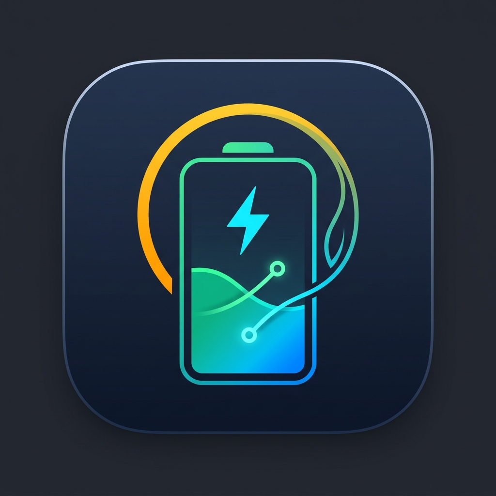
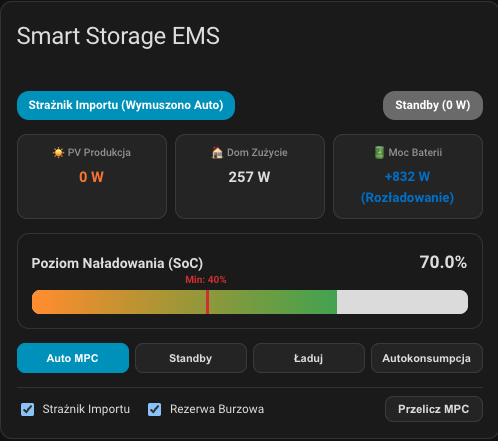
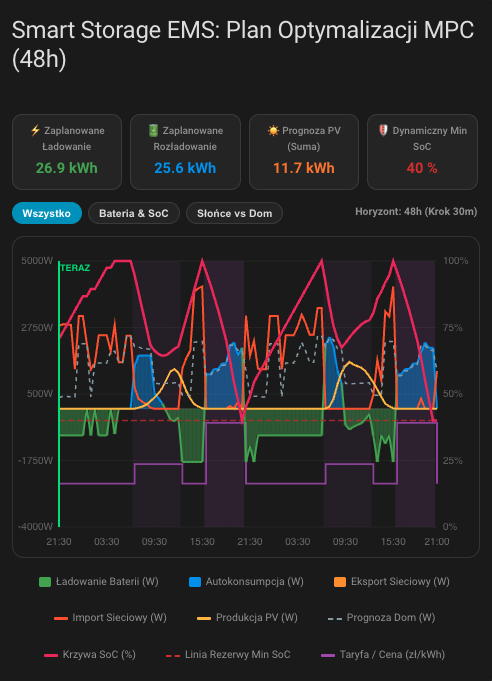
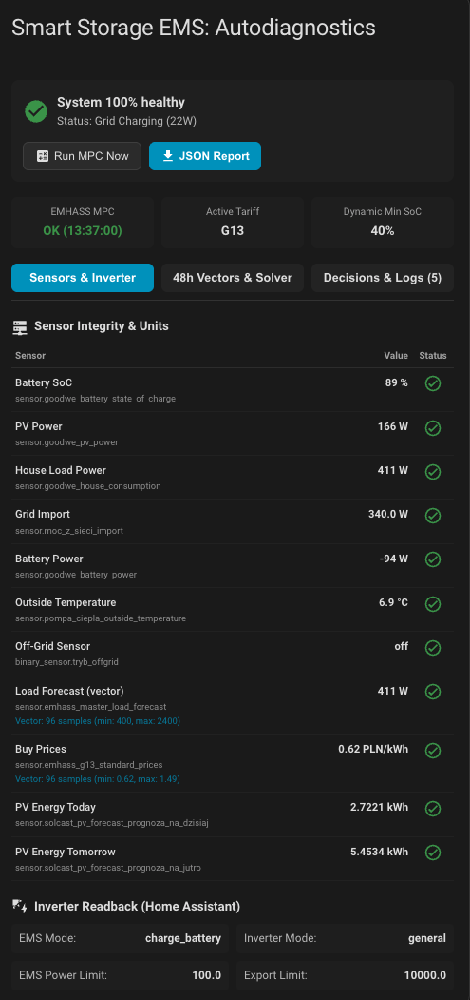
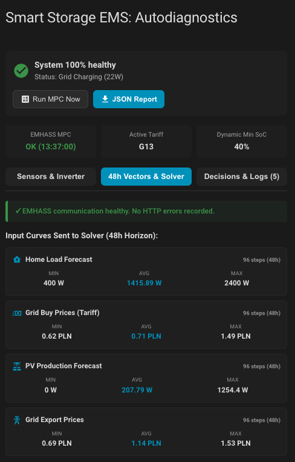

<p align="center">
  
</p>

# Smart Storage EMS 🔋⚡

<p align="center">
  <strong>🇬🇧 English</strong> &nbsp;|&nbsp; <a href="README.pl.md">🇵🇱 Polski (Wersja polska)</a>
</p>

[](https://my.home-assistant.io/redirect/hacs_repository/?owner=jannowakk&repository=ha-smart-storage-ems&category=integration)
[](https://github.com/hacs/default)
[](LICENSE)
[](https://buymeacoffee.com/jannowakk)

**Smart Storage EMS** is an intelligent, modular Energy Management System wrapper for **EMHASS** in Home Assistant that translates mathematical battery optimization plans into safe, real-world control of hybrid solar inverters.

Designed from the ground up to completely eliminate the need to maintain hundreds of lines of fragile Jinja2 templates, complex YAML automations, and manual `rest_command` calls.

> [!NOTE]
> **Project Status:** This integration is under active, rapid development. While it runs reliably and safely in real-world production setups (including GoodWe ET/ES + EMHASS), please do not expect a turnkey out-of-the-box solution for every arbitrary hardware setup yet. Feedback, testing, and contributions are very welcome!

---

## 📑 Table of Contents

* [💡 Design Philosophy](#-design-philosophy-balanced-home-ems-over-blind-arbitrage)
* [🌟 Key Features](#-key-features)
* [🏗️ Architecture](#️-architecture)
* [📦 Installation](#-installation)
* [🚀 Quick Start](#-quick-start)
* [⚙️ Exposed Entities](#️-exposed-entities)
* [📊 Dashboard Lovelace Cards](#-dashboard-lovelace-cards)
* [🔧 Advanced Options & Tuning](#-advanced-options--tuning)
* [❓ FAQ: Control Logic & EMS Strategy](#-faq-control-logic--ems-strategy)
* [🗺️ Roadmap](#️-roadmap)
* [📚 Real-World Case Studies](#-real-world-case-studies)
* [☕ Support the Project](#-support-the-project)
* [📄 License & Disclaimer](#-license--disclaimer)

---

## 💡 Design Philosophy: Balanced Home EMS Over Blind Arbitrage

When building this integration, the goal was to strike the **sweet spot between three pillars**:
1. **Home Energy Resilience** (grid outage backup buffer, reserving energy for heat pump operation during winter freezes).
2. **Battery Cell Longevity** (avoiding excessive micro-cycling during cheap off-peak tariffs and unnecessary high-C thermal wear).
3. **Genuine Electricity Bill Reduction** (leveraging off-peak tariff valleys, dynamic market prices, and surplus solar PV).

This system was engineered from the perspective of a **real single-family homeowner with a heat pump and a family**, not a speculative virtual power plant.

If you are looking for pure, aggressive energy-trading profit maximization regardless of battery degradation or blackout reserve risk, the conservative default thresholds may feel cautious.

However, the architecture is completely flexible:
* Through the **Options Flow** UI (*Configure*), you can lower the baseline `Min SoC` down to your battery's DoD floor (e.g. `10–15%`), switch the EMHASS cost function to `profit`, raise export power limits, and disable weather reserves—**effortlessly shifting the system from conservative protection toward aggressive grid arbitrage**.

---

## 🌟 Key Features

* **100% UI-Driven Setup (Config & Options Flow):** Select inverter entities, EMHASS settings, forecasts, and tariffs directly in Home Assistant without writing YAML.
* **GoodWe Inverter HAL:** Direct, register-safe control of GoodWe hybrid inverters (ET/ES/EH series) via EMS modes (`battery_standby`, `charge_battery`, `export_ac`, `auto/self_use`).
* **Zero Import Guard (Real-Time Protection):** Eliminates inverter response lag. If house import exceeds a configured safety threshold (e.g. `> 300 W`) while the battery has available charge above Min SoC, the Guard immediately enforces native self-consumption.
* **Off-Peak Battery Protection (Standby Mode):** During cheap tariff windows, the battery enters `battery_standby` so the house draws inexpensive grid power directly instead of burning battery cycles.
* **Dynamic Min SoC Buffer:** Automatically raises minimum battery reserve during winter months (Oct–Mar) based on outdoor temperature (frost factor) and active weather alerts (blackout protection).
* **Off-Grid Safety Lock:** Immediately freezes all EMS write commands to the inverter during grid outages / islanding mode, preserving EPS/Backup stability.
* **Built-In Forecasting & Tariff Engine:** Native 48h rolling PV generation (Solcast + Open-Meteo fallback), built-in parametric daily house load profiling (zero-load fallback), built-in Polish multi-zone tariffs (G13s, G13, G12w, G12, G12r, G12n, G11), and direct PSE RCE dynamic market price fetching.
* **Built-In Autodiagnostics:** Native HA diagnostics download (with automatic secret redaction) plus an interactive Lovelace Autodiagnostics card verifying sensors, units (`W` vs `kW`), 48h vectors, inverter readback, and live RAM logs.
* **Extensible HAL Architecture:** Clean Hardware Abstraction Layer (`BaseInverter`) ready for additional inverter drivers (Victron, Deye, Huawei).

---

## 🏗️ Architecture

```
┌────────────────────────────────────────────────────────┐
│               1. DATA INPUTS (UI FLOW)                 │
│  [Inverter Entities]  [Tariffs & RCE]   [PV Forecasts] │
└───────────────────────────┬────────────────────────────┘
                            │
┌───────────────────────────▼────────────────────────────┐
│         2. COORDINATOR & EMHASS CLIENT (Python)        │
│  • Automatic 48h (96-step) "from-now" slicing          │
│  • Clock-aligned EMHASS MPC run every 30 min           │
│  • Translates P_batt_forecast & P_grid_forecast        │
└───────────────────────────┬────────────────────────────┘
                            │
┌───────────────────────────▼────────────────────────────┐
│         3. ZERO IMPORT GUARD (REAL-TIME)               │
│  • Subscribes directly to grid import sensor events    │
│  • Reacts instantly when import exceeds safety limit   │
└───────────────────────────┬────────────────────────────┘
                            │
┌───────────────────────────▼────────────────────────────┐
│         4. INVERTER DRIVER (INVERTER HAL)              │
│  • Writes safe register modes (GoodWe / extensible)    │
└────────────────────────────────────────────────────────┘
```

---

## 📦 Installation

### Method 1: ⚡ 1-Click Install (Fastest – via My Home Assistant)
Click the badge below to open your Home Assistant instance and add this repository to HACS automatically:

[](https://my.home-assistant.io/redirect/hacs_repository/?owner=jannowakk&repository=ha-smart-storage-ems&category=integration)

1. Click **Add**, then **Download**.
2. **Restart Home Assistant**.
3. Go to **Settings -> Devices & Services -> Add Integration** and search for **Smart Storage EMS**.

---

### Method 2: HACS / Marketplace (Official Store)
Since **Smart Storage EMS** is included in the official HACS default repository (`hacs/default`):
1. Open **HACS** (or **Marketplace**) from the Home Assistant sidebar.
2. Search for **Smart Storage EMS**.
3. Click **Download**, then **Restart Home Assistant**.
4. Go to **Settings -> Devices & Services -> Add Integration** and search for **Smart Storage EMS**.

---

### Method 3: Manual Installation (Without HACS)
1. Download the latest release ZIP from the [Releases](https://github.com/jannowakk/ha-smart-storage-ems/releases) page.
2. Copy `custom_components/smart_storage_ems` into your Home Assistant `/config/custom_components/` directory.
3. **Restart Home Assistant** and add the integration via **Settings -> Devices & Services**.

---

## 🚀 Quick Start

Navigate to **Settings -> Devices & Services -> Add Integration -> Smart Storage EMS**. The setup wizard has 3 steps:

### 1. Inverter & Battery (GoodWe)
Map the entities provided by your GoodWe integration:
* **Battery SoC:** e.g. `sensor.goodwe_battery_state_of_charge`
* **PV Power:** e.g. `sensor.goodwe_pv_power`
* **House Consumption:** e.g. `sensor.goodwe_house_consumption`
* **Grid Import:** e.g. `sensor.grid_import_power` *(required for Zero Import Guard)*
* **Battery Power:** e.g. `sensor.goodwe_battery_power`
* **EMS Mode (`select`):** e.g. `select.goodwe_ems_mode`
* **Inverter Mode (`select`):** e.g. `select.goodwe_operation_mode`
* **EMS Power Limit (`number`):** e.g. `number.goodwe_ems_power_limit` *(for target charge/export watts)*
* **Grid Export Limit (`number`):** e.g. `number.goodwe_grid_export_limit`
* **Off-Grid Sensor (`binary_sensor`, optional):** e.g. `binary_sensor.goodwe_offgrid_mode`

### 2. EMHASS Connection
* **URL:** `http://localhost:5000` (port `5000` for EMHASS; `localhost` is automatically normalized to `127.0.0.1` to prevent IPv6 Docker issues).
* **API Token:** Required on EMHASS v0.18.10+ (leave blank for older versions).
* **Horizon:** `96` (48 hours in 30-minute intervals).
* **Cost Function:** `auto` (sunny surplus >14 kWh $\rightarrow$ `self-consumption`, price spike $\rightarrow$ `profit`, cloudy/winter $\rightarrow$ `cost`).

### 3. Forecasts & Tariffs
* **Buy Tariff:** Choose a built-in Polish TOU/flat tariff (`g13s`, `g13`, `g12w`, `g12`, `g12r`, `g12n`, `g11`) or `custom` to supply your own dynamic price sensor.
* **Sell Price Mode:** `pse_rce` (built-in official PSE API client), `sensor`, or `static`.
* **PV Forecast:** Select your 3 standard Solcast sensors (Today, Tomorrow, Day 3) — the integration automatically stitches and slices the 48h "from-now" vector.
* **House Load Forecast:** Leave blank to use the built-in zero-config parametric daily load template anchored to real-time house load, or supply your own 48h sensor.

---

## ⚙️ Exposed Entities

Once configured, the integration creates the following entities:

* `sensor.smart_storage_ems_status`: Current active EMS state (e.g. `Autokonsumpcja (Auto)`, `Ładowanie z sieci`, `Standby`).
* `sensor.smart_storage_ems_moc_zadana`: Target battery power setpoint in Watts.
* `sensor.smart_storage_ems_dynamiczny_min_soc`: Real-time calculated dynamic Min SoC (`%`).
* `sensor.smart_storage_ems_tryb_sezonowy`: Active thermodynamic mode (`lato` / `zima`).
* `sensor.smart_storage_ems_prognoza_pv_48h`: Generated 48h (96-step) rolling PV power forecast vector sent to EMHASS.
* `sensor.smart_storage_ems_prognoza_zuzycia_domu_48h`: Generated 48h (96-step) rolling house load forecast vector sent to EMHASS.
* `sensor.smart_storage_ems_diagnostyka` *(Diagnostic category)*: System health summary, entity checks, inverter readback, and recent EMS decision history.
* `select.smart_storage_ems_tryb_pracy`: Operation mode selector (`auto_mpc`, `hold_standby`, `force_charge`, `self_use`). Switching back to `auto_mpc` triggers an immediate MPC re-optimization.
* `switch.smart_storage_ems_straznik_importu`: Enable/disable Zero Import Guard.
* `switch.smart_storage_ems_rezerwa_burzowa`: Enable/disable weather/storm reserve boost.
* `button.smart_storage_ems_przelicz_mpc_teraz`: Button to immediately trigger an EMHASS MPC run.

---

## 📊 Built-In Lovelace Dashboard Cards

The integration automatically registers **three self-contained frontend cards** (100% vanilla Web Components—zero external HACS frontend dependencies required):

### 1. Control Card & Interactive 48h MPC Chart

| Control Card (`custom:smart-storage-card`) | 48h MPC Plan Chart (`custom:smart-storage-chart-card`) |
| :---: | :---: |
|  |  |

* **Control Card (`custom:smart-storage-card`):** Live SoC bar with dynamic reserve marker, real-time power flows, Zero Import Guard status, and quick mode controls.
* **48h MPC Chart (`custom:smart-storage-chart-card`):** Dual-axis HTML5 Canvas chart plotting planned battery charge/discharge power, projected SoC curve, PV forecast, house load, tariff zones, and KPI summary tiles with interactive legend toggles.

### 2. Autodiagnostics Card (New in v1.3.0!)

| Tab: Sensors & Inverter | Tab: 48h Vectors & Solver |
| :---: | :---: |
|  |  |

* **Autodiagnostics Card (`custom:smart-storage-diagnostic-card`):** Complete health-check control center organized into 3 tabs:
  * **Sensors & Inverter:** Automatic availability checks, unit-mismatch alerts (catching `kW` vs `W` scaling traps), 48h vector length/sample verification, and live inverter entity readback from Home Assistant.
  * **48h Vectors & Solver:** Min/avg/max summary statistics for house load, buy tariff, PV forecast, and sell price curves, plus full EMHASS HTTP error reporting.
  * **Decisions & Logs:** Recent EMS decision log with engineering reasons, alongside an in-memory RAM log terminal (`INFO`, `WARNING`, `ERROR`)—zero SQLite bloat.
  * **1-Click JSON Export:** *JSON Report* button generates and downloads a sanitized diagnostic bundle directly in the browser.

Example dashboard YAML configuration:

```yaml
type: vertical-stack
cards:
  - type: custom:smart-storage-card
    title: Smart Storage EMS
  - type: custom:smart-storage-chart-card
    title: "Smart Storage EMS: 48h MPC Optimization Plan"
    horizon_hours: 48
  - type: custom:smart-storage-diagnostic-card
    title: "Smart Storage EMS: Autodiagnostics"
```

---

## 🔍 Troubleshooting & Native Diagnostics

In addition to the Lovelace card, the integration implements Home Assistant's native Diagnostics platform:
* Navigate to **Settings -> Devices & Services -> Smart Storage EMS**.
* Open the three-dot menu (`⋮`) and select **Download diagnostics**.
* Home Assistant generates a sanitized JSON snapshot on the fly (API tokens and keys are automatically masked as `***REDACTED***`), containing environment versions, entity states/units, decision history, and the exact 96-step vectors sent to EMHASS—ready to attach to GitHub issues.

---

## 📖 Detailed Configuration Guide

> [!TIP]
> **No More Manual "From-Now" YAML Vectors:**
> EMHASS expects 48-hour (96-step) input arrays starting exactly **at the current 30-minute slot ("from now")** rather than midnight (`00:00`).
> * **PV Forecast:** Simply point the integration to your 3 standard Solcast sensors (Today, Tomorrow, Day 3)—it automatically parses `detailedForecast`, converts `kW` to `W`, stitches days together, and slices the continuous 96-step array starting from the current slot.
> * **House Load:** Leave empty for an adaptive daily household curve anchored to live load at step 0.
> * **Tariffs & RCE:** Generated continuously on a rolling clock-aligned basis.
> *Custom "from-now" sensors (`load_forecast_entity` / `pv_forecast_entity`) are only needed if you already maintain an advanced custom forecasting model.*

---

### Step 1: Inverter & Battery

| Field | Required | Expected Unit / Format | Notes & Common Pitfalls |
| :--- | :---: | :--- | :--- |
| **Inverter Type** | Yes | `goodwe` | Hardware Abstraction Layer (HAL) driver. Currently supports GoodWe ET/ES/EH series. |
| **Battery SoC Sensor** | Yes | `%` (`0–100`) | Current battery charge level, e.g. `sensor.goodwe_battery_state_of_charge`. |
| **Battery Power Sensor** | No | `W` (Watts) | Instantaneous charge/discharge power (used for UI card visualization). |
| **Current PV Power Sensor** | Yes | `W` (Watts) | Live solar production. Injected as `pv_now` (step 0) and evaluated by the solar-day threshold. |
| **House Consumption Sensor** | Yes | `W` (Watts) | Current building load. Injected as `load_now` (step 0) and used to compute dynamic export power. |
| **Grid Import Power Sensor** | No | `W` (Watts) | Live grid import (**positive** during import). **Required for Zero Import Guard.** |
| **EMS Mode Select** | Yes | `select.*` | Inverter EMS mode entity, e.g. `select.goodwe_ems_mode`. |
| **Inverter Mode Select** | Yes | `select.*` | General operation mode entity (used to return to native self-consumption). |
| **EMS Power Limit Number** | No | `number.*` (`W`) | Controls charge/export target wattage. Without it, forced charge/export cannot set power limits. |
| **Grid Export Limit Number** | No | `number.*` (`W`) | Ensures export limit does not remain throttled below `10000 W` when grid-tied. |
| **Off-Grid Binary Sensor** | No | `binary_sensor.*` | When `on` (grid loss / islanding), all inverter writes are strictly frozen to protect EPS/Backup power. |

---

### Step 2: EMHASS Connection

| Field | Required | Default | Description & Tips |
| :--- | :---: | :--- | :--- |
| **EMHASS Server URL** | Yes | `http://localhost:5000` | URL of your EMHASS server/add-on (port **5000**, not HA's 8123). Automatically maps `localhost` $\rightarrow$ `127.0.0.1` for Docker reliability. |
| **EMHASS API Token** | Optional* | *(empty)* | **Required for EMHASS v0.18.10+ (including v0.18.11+).** Enter the exact `emhass_api_token` string configured in your EMHASS add-on. Leave empty for older EMHASS versions. |
| **Prediction Horizon** | Yes | `96` | Number of 30-minute optimization steps (`96` = **48 hours**). |
| **Cost Function** | Yes | `auto` | `auto` (dynamically switches between `self-consumption`, `profit`, and `cost`) or explicit `cost` / `profit` / `self-consumption`. |

> [!IMPORTANT]
> **Required Pre-Configuration Inside EMHASS:**
> Before running optimizations, verify your EMHASS add-on configuration (`config_emhass.yaml` or Add-on UI) includes your physical hardware limits:
> * **`set_use_battery: true`** (defaults to `false` in stock EMHASS!).
> * **`optimization_time_step: 30`** (matches the 96-step 48h horizon).
> * **`battery_nominal_energy_capacity`** in Watt-hours (Wh), e.g. `10000` for a 10 kWh battery.
> * **`battery_maximum_charge_power` & `battery_maximum_discharge_power`** in Watts (W), e.g. `5000` or `8000`.
> * **`maximum_power_from_grid` & `maximum_power_to_grid`** set to the **lower** of your grid connection contract power or inverter nominal rating (e.g. `10000` W).

---

### Step 3: Tariffs, Forecasts & Safety Guards

* **Tariff Modes (`g13s` / `g13` / `g12w` / `g12` / `g12r` / `g12n` / `g11` / `custom`):**
  * Built-in rolling generators for Polish multi-zone tariffs (including statutory fixed and movable holidays), or `custom` to read your own dynamic price list sensor (`buy_price_entity` + `buy_price_attr`).
* **Sell Price Modes (`sell_price_mode`):**
  * `pse_rce` *(default)*: Fetches official 15-minute RCE prices directly from PSE S.A. (`api.raporty.pse.pl`), aggregates to 30-min steps, and applies an optional multiplier (e.g. `1.23` for VAT).
  * `sensor` or `static`.
* **Solar PV Forecasts:** Solcast (Today / Tomorrow / Day 3 `detailedForecast`), automatic Open-Meteo fallback, or custom 48h vector (`pv_forecast_entity`).
* **Zero Import Guard & Dynamic Reserves:**
  * `base_min_soc` & `winter_min_soc` use decimal fractions (e.g. `0.15` = `15%`, `0.50` = `50%`).
  * `outside_temp_entity` accepts any temperature sensor or `weather.*` entity to linearly scale winter Min SoC (`40%` at $0^\circ\text{C}$ up to `55%` at $-20^\circ\text{C}$).
  * `weather_alert_entity` raises reserve minimums (`>= 30%` summer, `>= 35%` winter) during severe weather alerts.

---

## ❓ FAQ: Control Logic & EMS Strategy

> [!NOTE]
> **Reference Installation:**  
> Algorithms were developed and field-tested on a live installation: **GoodWe ET hybrid inverter + GoodWe Lynx D HV battery (10 kWh)** operating on a 3-zone TOU tariff + **dynamic PSE RCE**, heat pump, and **EMHASS**. All thresholds are configurable via Options Flow.

1. **Why a hybrid control model between the inverter and EMHASS?**
   Continuous external `discharge_battery` commands suffer from network latency and throttle export. Instead, the inverter's native `self_use` + `auto` handles millisecond household load spikes, while EMS (`general`) takes over only for planned grid charging, off-peak `battery_standby`, and scheduled RCE export.
2. **Why does the system sometimes block battery discharging during off-peak hours?**
   Because of Round-Trip Efficiency ($\sim 81\%$) and cell stress cost. Discharging energy stored at `0.62 PLN/kWh` actually costs `~0.815 PLN/kWh`—burning battery charge when grid import costs `0.62 PLN/kWh` loses money and wastes valuable evening peak capacity. See the full mathematical breakdown in **[docs/CASE_STUDY_SOLVER_DECISIONS_EN.md](docs/CASE_STUDY_SOLVER_DECISIONS_EN.md)**.
3. **How is mode flapping prevented around Min SoC?**
   Winter Min SoC adapts dynamically to temperature, PV forecast, and weather warnings, protected by hysteresis: `auto` disables only when `SoC <= min_soc + 5%` (held for ≥ 30 s) and re-enables only after recharging to `SoC >= min_soc + 7%`. See the winter heat pump case study in **[docs/CASE_STUDY_MIN_SOC_HEAT_PUMP_EN.md](docs/CASE_STUDY_MIN_SOC_HEAT_PUMP_EN.md)**.
4. **How are Winter (`zima`) and Summer (`lato`) regimes switched?**
   Using solar thresholds (default `14 kWh` / `1000 W` PV): during heating season (Oct–Mar), nights stay in winter protection mode and switch to daytime self-consumption only once real PV exceeds `1000 W` (with cloud-bounce filtering).
5. **How is Off-Grid / EPS backup protected?**
   Whenever `binary_sensor_offgrid` turns `on`, all inverter register writes are blocked. Once grid power returns, EMS waits 5 seconds for voltage/frequency stabilization before restoring normal operation.

---

## 🗺️ Roadmap

- [x] MVP: EMHASS Long-MPC + GoodWe ET/ES Inverter HAL.
- [x] Real-time Zero Import Guard.
- [x] Dynamic Min SoC (Winter regime + Frost factor + Storm alerts).
- [x] Built-in Polish tariffs module (G13s, G13, G12w, G12, G12r, G12n, G11 with holiday calendar).
- [x] Custom Lovelace cards for real-time control and 48h MPC plan visualization.
- [x] Native zero-YAML forecast engine (Solcast + Open-Meteo fallback + built-in daily load template).
- [x] Direct PSE S.A. dynamic RCE price integration (`api.raporty.pse.pl`).
- [x] EMHASS Bearer Token support (`v0.18.10+` / `v0.18.11+`).
- [x] Built-in Autodiagnostics Lovelace card (`custom:smart-storage-diagnostic-card`) & HA native diagnostics.
- [x] 🧪 **[BETA]** Inverter HAL expansion: Deye (SunSynk/Sol-Ark), Hoymiles (HIT-G3), and Sofar Solar (HYD) support.
- [x] 🧪 **[BETA]** Passive Load Observer (P85): background 85th percentile load calculation directly from HA recorder history (dual workday vs weekend curves).
- [ ] 📋 Shift-work & Home Office calendar integration (Google/iCal day shift / night shift / remote archetypes with HVAC automation hooks).
- [ ] 📋 Smart Home helper binary sensors: Cheap Tariff Active, PV Surplus Over Battery & Load (Power-to-Heat / DHW diversion / EV hooks).
- [ ] 📋 Grid Phase & Current Guard: dynamic per-phase current limiter preventing main breaker trips during EV charging and heat pump cycles.
- [ ] 📋 PGE G12e flexible solar tariff support (month-dependent solar off-peak windows).
- [ ] 📋 Intuitive `-1 / 0 / +1` EMHASS tuning sliders (Charge/Discharge bias, arbitrage vs cell protection, SoC buffer stiffness).
- [ ] 📋 Additional inverter HAL drivers: Victron MultiPlus-II / ESS, SolaX Hybrid, Huawei LUNA.

---

## 📚 Real-World Case Studies

In-depth technical and economic breakdowns documenting actual operational telemetry from live installations:

* **[Case Study: Why Did the Optimizer Avoid Discharging in the Cheap Valley?](docs/CASE_STUDY_SOLVER_DECISIONS_EN.md)**  
  Mathematical breakdown of 81% round-trip efficiency, cell stress costs, and why draining the battery during cheap off-peak rates generates a financial loss over a 48h horizon.
* **[Case Study: Dynamic Min SoC Protection During Winter Heat Pump Peak](docs/CASE_STUDY_MIN_SOC_HEAT_PUMP_EN.md)**  
  High-drain (~3.8 kW) cold weather behavior, how the inverter halts discharge at 40% Min SoC, and how EMHASS sizes afternoon charging to 89% to match evening peak demand without grid stress.

---

## ☕ Support the Project

If **Smart Storage EMS** has helped optimize your home battery, reduced your electricity bills, or protected your inverter from wear, consider supporting ongoing development:

[](https://buymeacoffee.com/jannowakk)

---

## 📄 License & Disclaimer

Distributed under the **[GNU GPL v3](LICENSE)** license ([informational Polish summary](LICENSE_PL.md)).

> [!WARNING]
> **Disclaimer (Use at Your Own Risk):**
> This software is provided **"AS IS"**, without warranty of any kind, express or implied (pursuant to Sections 15 and 16 of the GNU GPL v3). This integration writes operational commands directly to inverter hardware and battery storage. The author assumes no liability for hardware damage, system faults, energy loss, or financial loss resulting from installing, configuring, or using this software. You use this project entirely at your own risk.
