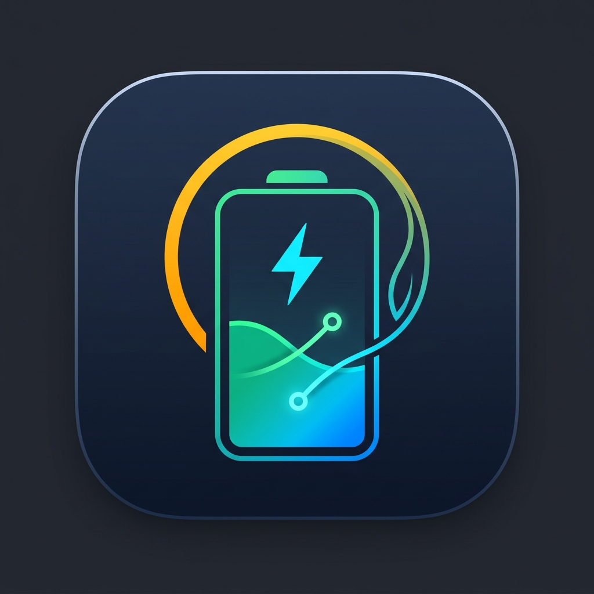
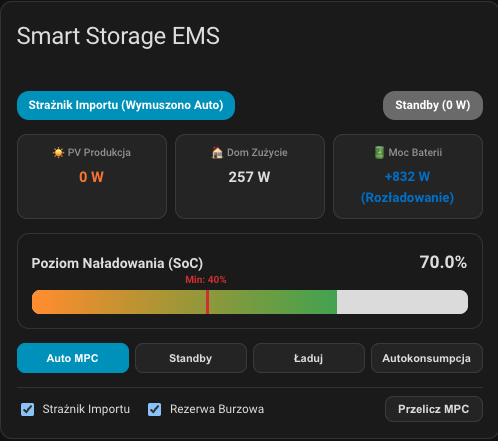
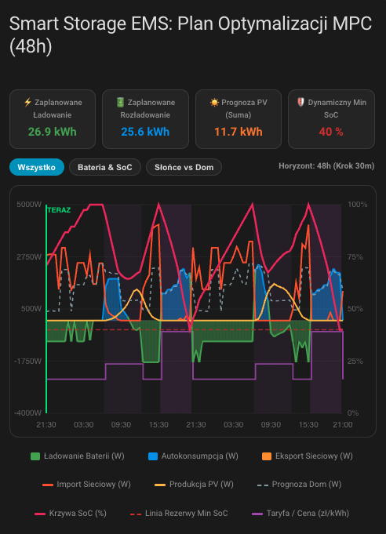
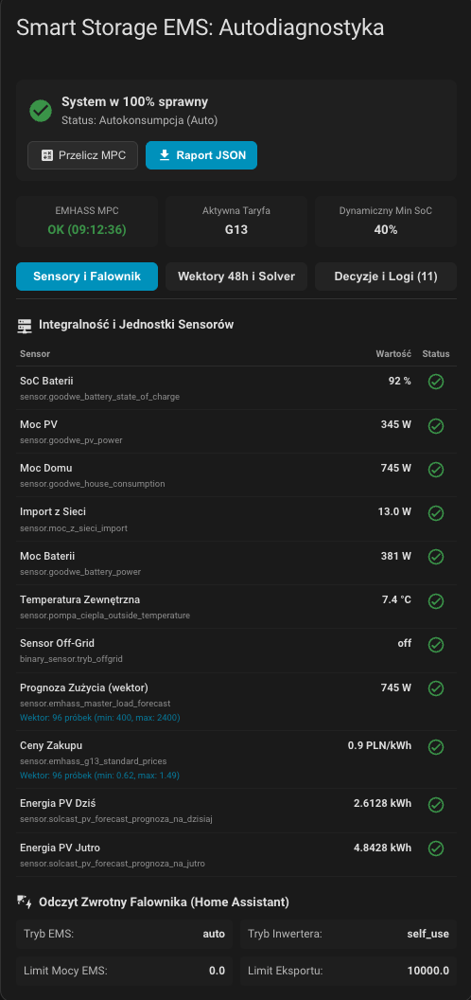
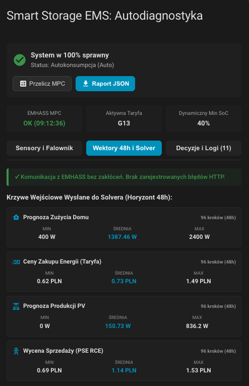

<p align="center">
  
</p>

# Smart Storage EMS 🔋⚡

<p align="center">
  <a href="README.md">🇬🇧 English</a> | <strong>🇵🇱 Polski</strong>
</p>

[](https://my.home-assistant.io/redirect/hacs_repository/?owner=jannowakk&repository=ha-smart-storage-ems&category=integration)
[](https://github.com/hacs/default)
[](LICENSE)
[](https://buycoffee.to/jannowakk)
[](https://buymeacoffee.com/jannowakk)

**Smart Storage EMS** to inteligentna, modułowa nakładka (Energy Management System) na **EMHASS** dla Home Assistant, która przekształca matematyczne plany optymalizacji baterii w bezpieczne, fizyczne sterowanie falownikiem hybrydowym.

Zaprojektowana tak, aby całkowicie wyeliminować konieczność pisania setek linijek szablonów Jinja2, skomplikowanych automatyzacji i rest_commandów w YAML.

> [!NOTE]
> **Status projektu:** Integracja znajduje się w fazie intensywnego, aktywnego rozwoju. Chociaż działa stabilnie i bezpiecznie w instalacjach produkcyjnych (m.in. GoodWe ET/ES + EMHASS), nie należy oczekiwać bezobsługowego „gotowca OOB” pod każdą dowolną konfigurację sprzętową. Zachęcamy do zgłaszania uwag, testowania i współtworzenia projektu!

---

## 📑 Spis Treści

* [💡 Filozofia Projektu: Zrównoważony EMS zamiast Ślepego Arbitrażu](#-filozofia-projektu-zrównoważony-ems-zamiast-ślepego-arbitrażu)
* [🌟 Kluczowe Funkcje (Features)](#-kluczowe-funkcje-features)
* [🏗️ Architektura](#️-architektura)
* [📦 Instalacja](#-instalacja)
* [🚀 Szybki Start (Krok po kroku)](#-szybki-start-krok-po-kroku)
* [⚙️ Wystawiane Encje](#️-wystawiane-encje)
* [📊 Karty Dashboardu Lovelace](#-karty-dashboardu-lovelace)
* [🔧 Zaawansowane Opcje i Dostrajanie](#-zaawansowane-opcje-i-dostrajanie)
* [❓ FAQ (Najczęściej Zadawane Pytania)](#-faq-najczęściej-zadawane-pytania)
* [🗺️ Roadmapa Rozwoju](#️-roadmapa-rozwoju)
* [📚 Studia Przypadków (Real-World Case Studies)](#-studia-przypadków-real-world-case-studies)
* [☕ Wesprzyj projekt](#-wesprzyj-projekt)
* [📄 Licencja i Zastrzeżenie (Disclaimer)](#-licencja-i-zastrzeżenie-disclaimer)

---

## 💡 Filozofia Projektu: Zrównoważony EMS zamiast Ślepego Arbitrażu

Tworząc tę integrację, moim głównym celem było znalezienie **złotego środka pomiędzy trzema filarami**:
1. **Bezpieczeństwem energetycznym domu** (stabilność zasilania, bufor awaryjny na wypadek blackoutu, zapas energii dla pompy ciepła w czasie mrozów).
2. **Ochroną żywotności ogniw magazynu** (unikanie „zarzynania” baterii zbędnymi mikrocyklami w tanich strefach oraz eliminacja przegrzewania ciągłym drenażem).
3. **Minimalizacją realnych rachunków za prąd** (wykorzystanie dolin cenowych G12w/G13 i taniego prądu z PV).

Ten system powstał z perspektywy **właściciela prawdziwego domu jednorodzinnego z pompą ciepła i rodziną**, a nie wirtualnej elektrowni spekulacyjnej. 

Jeśli szukasz rozwiązania nastawionego wyłącznie na agresywną, bezwzględną maksymalizację zysku z handlu energią kosztem degradacji chemii baterii i ryzyka braku prądu przy awarii sieci – domyślne nastawy mogą wydać Ci się zbyt ostrożne. 

Jednak architektura integracji jest w pełni elastyczna:
* Poprzez odpowiednie dostrojenie parametrów w formularzu konfiguracyjnym (*Options Flow*) – m.in. obniżenie bazowego `Min SoC` do poziomu DoD (np. 10–15%), zmianę funkcji celu w EMHASS na `profit`, podniesienie limitu mocy eksportu oraz wyłączenie buforów pogodowych – **możesz łatwo przechylić szalę z trybu zachowawczego w stronę agresywnego arbitrażu rynkowego i maksymalizacji przychodów ze sprzedaży do sieci**.

---

## 🌟 Kluczowe Funkcje (Features)

* **Plug & Play przez UI (Config Flow):** Konfiguracja w 100% w interfejsie Home Assistant – wybierasz encje falownika, EMHASS i taryfę z list rozwijanych.
* **GoodWe Inverter HAL:** Natywne, bezpośrednie sterowanie inwerterami hybrydowymi GoodWe (ET, ES) poprzez rejestry EMS (`battery_standby`, `charge_battery`, `export_ac`, `auto/self_use`).
* **Strażnik Importu (Zero Import Guard):** Moduł czasu rzeczywistego eliminujący lagi inwertera. Jeśli dom zaczyna pobierać drogi prąd z sieci powyżej zadanego progu (np. >300 W), a bateria posiada ładunek, Strażnik natychmiast wymusza tryb autokonsumpcji.
* **Ochrona w Taniej Strefie (Standby Mode):** Gdy prąd w taryfie strefowej (np. G13 / G12w) jest tani, bateria przechodzi w tryb `battery_standby`, aby nie zużywać cykli akumulatora na zasilanie domu.
* **Dynamiczny Bufor Rezerwy (Dynamic Min SoC):** Automatyczne podnoszenie minimalnego poziomu naładowania na zimę (październik–marzec) oraz przy ostrzeżeniach burzowych IMGW (ochrona przed blackoutem).
* **Bezpiecznik Off-Grid:** Natychmiastowe zamrożenie operacji EMS w przypadku zaniku sieci energetycznej, gwarantujące stabilność zasilania awaryjnego.
* **Architektura gotowa na rozbudowę:** Odseparowana warstwa HAL (Hardware Abstraction Layer) umożliwiająca łatwe dodanie kolejnych producentów falowników (Deye, Victron, Huawei).

---

## 🏗️ Architektura

```
┌────────────────────────────────────────────────────────┐
│               1. WEJŚCIE DANYCH (UI FLOW)              │
│  [Encje Falownika]    [Ceny G12/G13/RCE]   [Prognozy PV]│
└───────────────────────────┬────────────────────────────┘
                            │
┌───────────────────────────▼────────────────────────────┐
│         2. KOORDYNATOR & KLIENT EMHASS (Python)        │
│  • Automatyczne cięcie i dopasowanie wektorów 48h      │
│  • Cykliczne wywołanie EMHASS MPC (co 30 min)          │
│  • Interpretacja P_batt_forecast i P_grid_forecast     │
└───────────────────────────┬────────────────────────────┘
                            │
┌───────────────────────────▼────────────────────────────┐
│         3. STRAŻNIK IMPORTU (CZAS RZECZYWISTY)         │
│  • Nasłuch zdarzeń licznika sieciowego                 │
│  • Reakcja na pobór mocy > progu bezpieczeństwa        │
└───────────────────────────┬────────────────────────────┘
                            │
┌───────────────────────────▼────────────────────────────┐
│         4. DRIVER FALOWNIKA (INVERTER HAL)             │
│  • Tłumaczenie na rejestry GoodWe / Deye / Victron     │
└────────────────────────────────────────────────────────┘
```

---

## 📦 Instalacja

### Metoda 1: ⚡ 1-Click Install (Najszybsza – przez My Home Assistant)
Kliknij poniższy przycisk, aby bezpośrednio otworzyć swoją instancję Home Assistant i automatycznie dodać to repozytorium:

[](https://my.home-assistant.io/redirect/hacs_repository/?owner=jannowakk&repository=ha-smart-storage-ems&category=integration)

Po otwarciu okna:
1. Kliknij **Dodaj (Add)**, a następnie **Pobierz (Download)**.
2. **Zrestartuj Home Assistant**.
3. Przejdź do **Ustawienia -> Urządzenia i usługi -> Dodaj integrację** i wyszukaj **Smart Storage EMS**.

---

### Metoda 2: HACS / Marketplace (Oficjalny katalog)
Integracja **Smart Storage EMS** znajduje się w oficjalnym katalogu HACS (`hacs/default`):
1. W menu bocznym Home Assistant otwórz **HACS** (lub **Marketplace**).
2. Wyszukaj: **Smart Storage EMS**.
3. Kliknij **Pobierz**, a następnie **Zrestartuj Home Assistant**.
4. Przejdź do **Ustawienia -> Urządzenia i usługi -> Dodaj integrację** i skonfiguruj integrację przez kreator.

---

### Metoda 3: Ręcznie (bez HACS)
1. Pobierz najnowsze wydanie (ZIP) z zakładki [Releases](https://github.com/jannowakk/ha-smart-storage-ems/releases).
2. Skopiuj katalog `custom_components/smart_storage_ems` do folderu `/config/custom_components/` w swoim Home Assistant.
3. Zrestartuj Home Assistant i dodaj integrację przez **Ustawienia -> Urządzenia i usługi**.

---

## 🚀 Szybki start

Po zainstalowaniu integracji przejdź do **Ustawienia -> Urządzenia i usługi -> Dodaj integrację -> Smart Storage EMS**. 

Kreator składa się z 3 kroków:

### 1. Falownik (GoodWe)
Wskaż encje ze swojej integracji falownika. Poniższy zestaw encji jest potrzebny, aby integracja mogła zadawać moce i chronić przed drogim importem:

* **SoC baterii:** np. `sensor.goodwe_battery_state_of_charge`
* **Moc PV:** np. `sensor.goodwe_pv_power`
* **Pobór domu:** np. `sensor.goodwe_load_power`
* **Moc sieci (Grid in/out):** np. `sensor.goodwe_active_power` *(dla Strażnika Importu)*
* **Moc baterii:** np. `sensor.goodwe_battery_power`
* **Tryb EMS:** np. `select.goodwe_ems_mode`
* **Tryb inwertera:** np. `select.goodwe_operation_mode`
* **Limit mocy EMS:** np. `number.goodwe_ems_power_limit` *(do zadawania mocy ładowania/rozładowania)*
* **Limit eksportu:** np. `number.goodwe_export_limit` *(do arbitrażu RCE)*
* **Praca wyspowa (opcjonalnie):** np. `binary_sensor.goodwe_on_grid`

### 2. Połączenie z EMHASS
* **URL:** `http://localhost:5000`
* **Horyzont:** `96` (48h w krokach 30-minutowych)
* **Funkcja celu:** `auto` (zima: cost, lato: self-consumption, szpila RCE: profit)

### 3. Taryfy i prognozy
* **Ceny zakupu:** Wybierz `G13` lub `G12w` (stawki i kalendarz świąt są wbudowane).
* **Ceny sprzedaży:** Wybierz `Wbudowane PSE S.A. (RCE)` (pobiera oficjalne ceny z API PSE bez żadnych encji w HA).
* **Prognoza PV:** Wskaż 3 standardowe sensory Solcast (dziś, jutro, pojutrze) – integracja sama tnie wektor 48h od bieżącej półgodziny.
* **Prognoza zużycia domu:** Zostaw puste pole (integracja sama wygeneruje profil dobowy zakotwiczony w bieżącym poborze).

---

## ⚙️ Wystawiane Encje

Po dodaniu integracji otrzymujesz gotowe encje do sterowania i dashboardów Lovelace:

* `sensor.smart_storage_ems_status`: Aktualny stan logiki (np. `Autokonsumpcja (Auto)`, `Ładowanie z sieci (3000W)`, `Standby (Oszczędzanie w taniej strefie)`).
* `sensor.smart_storage_ems_moc_zadana`: Obliczona moc zadana dla baterii w Watach.
* `sensor.smart_storage_ems_dynamiczny_min_soc`: Dynamiczny próg rezerwy w %.
* `sensor.smart_storage_ems_tryb_sezonowy`: Aktualny tryb sezonowy (`lato` / `zima`).
* `sensor.smart_storage_ems_prognoza_pv_48h`: Wygenerowany ciągły wektor prognozy mocy PV na 48h (96 kroków) przekazywany do EMHASS.
* `sensor.smart_storage_ems_prognoza_zuzycia_domu_48h`: Wygenerowany ciągły wektor prognozy zużycia domu na 48h (96 kroków) przekazywany do EMHASS.
* `select.smart_storage_ems_tryb_pracy`: Przełącznik trybu (`auto_mpc`, `hold_standby`, `force_charge`, `self_use`).
* `switch.smart_storage_ems_straznik_importu`: Włącznik/wyłącznik Strażnika Importu.
* `switch.smart_storage_ems_rezerwa_burzowa`: Włącznik rezerwy na wypadek burzy / blackoutu.
* `button.smart_storage_ems_przelicz_mpc_teraz`: Przycisk natychmiastowego wymuszenia optymalizacji.

---

## 📊 Wbudowane Karty Dashboardu Lovelace

Integracja automatycznie rejestruje trzy dedykowane karty frontendowe (w 100% czyste Web Components, bez zewnętrznych zależności i bez potrzeby instalacji dodatków z HACS):

### 1. Karta Sterująca oraz Interaktywny Wykres 48h MPC

| Karta Sterująca (`custom:smart-storage-card`) | Interaktywny Wykres 48h MPC (`custom:smart-storage-chart-card`) |
| :---: | :---: |
|  |  |

* **Karta sterująca (`custom:smart-storage-card`)** – podgląd SoC z markerem dynamicznej rezerwy, parametry mocy w czasie rzeczywistym, wskaźnik Strażnika Importu oraz szybkie przyciski zmiany trybu pracy.
* **Interaktywny wykres 48h MPC (`custom:smart-storage-chart-card`)** – dwuosiowy wykres Canvas pokazujący plan ładowania/rozładowania baterii, krzywą SoC, prognozę PV, zużycie domu, strefy taryfowe oraz kafle podsumowań KPI (z w pełni interaktywną legendą).

### 2. Karta Autodiagnostyki Systemu (Nowość w v1.3.0!)

| Zakładka: Sensory i Falownik | Zakładka: Wektory 48h i Solver |
| :---: | :---: |
|  |  |

* **Karta autodiagnostyczna (`custom:smart-storage-diagnostic-card`)** – kompletne centrum kontroli zdrowia systemu w 3 przejrzystych zakładkach:
  * **Sensory i Falownik:** Automatyczna weryfikacja dostępności encji, wskaźniki poprawności, wykrywanie pułapek skali jednostek (alert przy `kW` zamiast `W`), audyt długości i próbek wektorów oraz odczyt stanów falownika w Home Assistant.
  * **Wektory 48h i Solver:** Statystyki min/śr/max dla prognozy zużycia domu, taryfy zakupu, prognozy PV i wyceny RCE, a także rejestr ewentualnych błędów komunikacji z solverem EMHASS.
  * **Decyzje i Logi:** Dziennik ostatnich decyzji silnika EMS oraz terminal z buforem logów w pamięci RAM (`INFO`, `WARNING`, `ERROR`).
  * **Pobieranie raportu:** Przycisk *Raport JSON* umożliwiający pobranie zanonimizowanego pliku diagnostycznego jednym kliknięciem bezpośrednio w przeglądarce.

Przykładowa konfiguracja YAML w dashboardzie:

```yaml
type: vertical-stack
cards:
  - type: custom:smart-storage-card
    title: Smart Storage EMS
  - type: custom:smart-storage-chart-card
    title: "Smart Storage EMS: Plan Optymalizacji MPC (48h)"
    horizon_hours: 48
  - type: custom:smart-storage-diagnostic-card
    title: "Smart Storage EMS: Autodiagnostyka"
```

---

## 🔍 Narzędzia Diagnostyczne i Rozwiązywanie Problemów

Oprócz dedykowanej karty na pulpicie, integracja wspiera natywny mechanizm diagnostyki Home Assistant:
* Przejdź do: **Ustawienia -> Urządzenia oraz usługi -> Smart Storage EMS**.
* W menu z trzema kropkami (`⋮`) wybierz opcję **„Pobierz diagnostykę”** (*Download diagnostics*).
* Home Assistant wygeneruje w locie zanonimizowany plik JSON (tokeny i hasła są maskowane jako `***REDACTED***`), zawierający pełny stan środowiska, rejestr encji, historię decyzji oraz wektory wejściowe EMHASS – idealny do dołączenia do zgłoszeń błędów na GitHubie lub forum.

---

## 📖 Przewodnik Konfiguracji (Opis pól formularza)

Poniżej znajduje się szczegółowe wyjaśnienie każdego pola z kreatora konfiguracji oraz menu opcji (zębatki).

> [!TIP]
> **Koniec z ręcznym tworzeniem wektorów „od teraz” w YAML (Nowość w v1.1.0!):**
> EMHASS wymaga na wejściu wektorów 48-godzinnych (96 kroków) zaczynających się dokładnie **od bieżącego 30-minutowego slotu („od teraz”)**, a nie od północy (`00:00`).
> **Od wersji v1.1.0 integracja całkowicie zdejmuje ten ciężar z użytkownika:**
> * **Prognoza PV:** Wystarczy wskazać 3 standardowe sensory Solcast (Dziś, Jutro, Dzień 3) – integracja sama odczytuje `detailedForecast`, składa dni i kroi ciągły wektor „od teraz”.
> * **Prognoza zużycia domu:** Jeśli pozostawisz pole puste, integracja sama generuje realistyczny dobowy profil domowy (noc ~350 W, poranek ~600 W, dzień ~450 W, wieczór ~800 W) dopasowany do dni roboczych i świąt w Polsce, kroi go „od teraz”, a slot 0 kotwiczy do bieżącego poboru domu!
> * **Ceny taryfowe (G13 / G12w) oraz RCE (PSE S.A.):** Są generowane krocząco w 100% automatycznie.
> *Ręczne wektory „od teraz” (`load_forecast_entity` / `pv_forecast_entity`) są potrzebne wyłącznie wtedy, gdy masz własny, zaawansowany model master.*

---

### Krok 1: Falownik i Bateria

| Pole w formularzu | Wymagane? | Oczekiwana wartość / Jednostka | Opis i częste pułapki |
| :--- | :---: | :--- | :--- |
| **Typ falownika** | Tak | `goodwe` | Wybór sterownika sprzętowego (HAL). Obecnie wspierana jest seria GoodWe ET/ES/EH. |
| **Sensor poziomu naładowania (SoC)** | Tak | `%` (`0–100`) | Aktualny stan baterii w procentach, np. `sensor.goodwe_battery_state_of_charge`. |
| **Sensor mocy baterii** | Nie | `W` (Waty) | Chwilowa moc ładowania/rozładowania baterii (np. `sensor.goodwe_battery_power`). Używana do wizualizacji na karcie sterującej. |
| **Sensor aktualnej produkcji PV** | Tak | `W` (Waty) | Bieżąca moc z paneli PV (np. `sensor.goodwe_pv_power`). Wstrzykiwana jako `pv_now` (krok 0) do EMHASS oraz używana przez przełącznik trybu letniego (próg W). |
| **Sensor zużycia domu (House Load)** | Tak | `W` (Waty) | Aktualne zapotrzebowanie budynku na moc (np. `sensor.goodwe_house_consumption`). Wstrzykiwana jako `load_now` (krok 0) oraz używana do wyliczania mocy eksportu. |
| **Sensor poboru mocy z sieci (Import)** | Nie | `W` (Waty) | Chwilowy pobór energii z sieci (wartość **dodatnia** podczas importu, np. `sensor.moc_z_sieci_import`). **Wymagany, jeśli chcesz używać Strażnika Importu.** |
| **Encja trybu EMS (`select`)** | Tak | encja `select.*` | Encja sterująca trybem EMS w falowniku GoodWe, np. `select.goodwe_ems_mode`. |
| **Encja trybu falownika (`select`)** | Tak | encja `select.*` | Ogólny tryb pracy falownika (np. `select.goodwe_tryb_pracy_falownika`), wykorzystywany m.in. do powrotu w tryb autokonsumpcji (`general`). |
| **Encja limitu mocy EMS (`number`)** | Nie | encja `number.*` (W) | Encja ustawiająca moc ładowania/eksportu w Watach, np. `number.goodwe_ems_power_limit`. Bez niej wymuszone ładowanie/eksport nie ustawi docelowej mocy. |
| **Encja limitu eksportu do sieci (`number`)** | Nie | encja `number.*` (W) | Np. `number.goodwe_grid_export_limit`. Integracja pilnuje, by limit nie spadł poniżej `10000 W` (odblokowany eksport). |
| **Sensor trybu Off-Grid** | Nie | `binary_sensor.*` | Gdy ma stan `on` (zanik sieci / praca wyspowa), integracja natychmiast zamraża zapisy do falownika dla bezpieczeństwa zasilania awaryjnego. |

---

### Krok 2: Połączenie z EMHASS

| Pole w formularzu | Wymagane? | Domyślnie | Opis i wskazówki |
| :--- | :---: | :--- | :--- |
| **Adres URL EMHASS** | Tak | `http://localhost:5000` | Adres serwera/dodatku EMHASS. Pamiętaj o porcie **5000** (nie 8123 od HA!). Klient automatycznie zamienia `localhost` na `127.0.0.1`, aby uniknąć problemów z IPv6 w Dockerze. |
| **Token API EMHASS** | Opcjonalne* | *(puste)* | **Wymagany od EMHASS v0.18.10+ (w tym v0.18.11+).** Wpisz dowolny, ale **dokładnie ten sam ciąg znaków**, który ustawiłeś w konfiguracji dodatku EMHASS (`emhass_api_token`). W starszych wersjach EMHASS (< v0.18.10) pozostaw to pole puste (pełna kompatybilność wsteczna). |
| **Horyzont optymalizacji** | Tak | `96` | Liczba kroków 30-minutowych liczonych do przodu. `96` kroków = **48 godzin**. |
| **Funkcja celu** | Tak | `auto` | Tryb optymalizacji EMHASS: `auto` (zalecany: automatycznie przełącza na `self-consumption` w słoneczny dzień >14 kWh, `profit` podczas szpil cenowych PSE RCE, a `cost` w pochmurne/zimowe dni) lub ręczny wybór: `cost`, `profit`, `self-consumption`. |

> [!NOTE]
> **Kompatybilność z EMHASS v0.18.10+ i v0.18.11+ (Token Bearer):**  
> Nowsze wersje EMHASS wymagają nagłówka `Authorization: Bearer <emhass_api_token>` przy wywoływaniu endpointów `/action/naive-mpc-optim` oraz `/action/publish-data`.  
> **Jak to skonfigurować w praktyce?** Nie musisz generować żadnych skomplikowanych kluczy:
> 1. W opcjach dodatku EMHASS (*Ustawienia -> Dodatki -> EMHASS -> Konfiguracja*) w polu `emhass_api_token` wpisz **dowolny, wymyślony przez siebie ciąg znaków** (np. `moj_tajny_token_123` lub dowolne hasło).
> 2. Dokładnie **ten sam ciąg znaków** wpisz w formularzu naszej integracji w polu **Token API EMHASS**.
> W przypadku starszych wersji EMHASS (< v0.18.10) pole można pozostawić puste.

> [!IMPORTANT]
> **Wymagana wstępna konfiguracja w samym dodatku EMHASS:**
> Zanim uruchomisz integrację, upewnij się, że w konfiguracji dodatku EMHASS (*Ustawienia -> Dodatki -> EMHASS -> Konfiguracja* lub w pliku `config_emhass.yaml`) ustawiłeś parametry fizyczne swojej instalacji:
> * **`set_use_battery: true`** – włącza modelowanie i optymalizację baterii (domyślnie w czystym EMHASS jest `false`!).
> * **`optimization_time_step: 30`** – krok czasowy 30 minut (dopasowany do 96 kroków horyzontu 48h).
> * **`battery_nominal_energy_capacity`** – pojemność znamionowa Twojego magazynu w Watogodzinach (Wh), np. `9600` lub `10000` dla baterii ~10 kWh.
> * **`battery_maximum_charge_power` & `battery_maximum_discharge_power`** – maksymalna moc ładowania i rozładowania baterii w Watach (W), np. `5000` lub `8000`.
> * **`maximum_power_from_grid` & `maximum_power_to_grid`** – moc umowna przyłącza w Watach lub moc nominalna falownika w Watach (wpisz **tę niższą z dwóch**, np. `10000`), aby solver nie planował niemożliwych fizycznie przepływów sieciowych.

---

### Krok 3: Taryfy, Prognozy i Zabezpieczenia

#### A. Model taryfowy i ceny zakupu/sprzedaży
* **Model taryfy energii (`g13s` / `g13` / `g12w` / `g12` / `g12r` / `g12n` / `g11` / `custom`):**
  * **`g13s` (Tauron):** Specjalna taryfa dla prosumentów z PV i magazynem energii. Uwzględnia sezon letni (1.04-30.09) ze strefą słoneczną T3 (13:00-16:00), sezon zimowy (1.10-31.03) oraz weekendy i święta.
  * **`g13` (Tauron):** Standardowa taryfa trójstrefowa (T1 przedpołudnie, T2 szczyt popołudniowy, T3 dolina nocna i popołudniowa).
  * **`g12w` / `g12`:** Klasyczne taryfy dwustrefowe (dzień / noc i weekendy).
  * **`g12r` (Energa) / `g12n` (PGE):** Dedykowane profile dwustrefowe OSD z rozszerzonymi dolinami pozaszczytowymi.
  * **`g11`:** Taryfa jednostrefowa (płaska) do optymalizacji magazynu pod ceny dynamiczne RCE.
  * **`custom`:** Własny cennik lub taryfa dynamiczna przekazywana w zewnętrznym sensorze.
* **Ceny w strefach T1 / T2 / T3 (zł/kWh):** Konfigurowalne stawki brutto dla poszczególnych stref taryfowych.
* **Sensor cen zakupu (`buy_price_entity`) + Atrybut listy (`buy_price_attr`, domyślnie `list`):** Używane **tylko w trybie `custom`**. Wskazany sensor musi mieć w wybranym atrybucie listę cen (np. `[0.62, 0.62, 0.90, ...]`) w zł/kWh co 30 min, zaczynającą się **„od teraz”**. Jeśli lista będzie pusta lub błędna, przyjmie domyślne `0.65 zł/kWh`.
* **Model cen sprzedaży / eksportu energii (`sell_price_mode`):**
  * **`pse_rce` (Domyślny / Zalecany dla Polski):** Integracja automatycznie pobiera dynamiczne ceny rynkowe RCE bezpośrednio z oficjalnego API PSE S.A. (`api.raporty.pse.pl`), agreguje je z kwadransów (15 min) do 30 minut i generuje łańcuch kroczący na 48h. Dostępny jest także konfigurowalny **mnożnik cen PSE RCE** (domyślnie `1.00`, lub np. `1.23` przy rozliczaniu Net-Billing z VAT).
  * **`sensor`:** Opcjonalna lista cen sprzedaży energii do sieci z zewnętrznego sensora w zł/kWh co 30 min **„od teraz”** (`sell_price_entity` + `sell_price_attr`).
  * **`static`:** Stała cena sprzedaży (`sell_price_static`, domyślnie `0.40 zł/kWh`).

#### B. Prognoza fotowoltaiki (Natywny generator bez szablonów Jinja2!)
Integracja całkowicie eliminuje potrzebę ręcznego tworzenia wektorów 48h w YAML:

1. **Główne źródło – Solcast (Zalecane):**
   * Podaj 3 standardowe sensory Solcast: **Dzisiaj** (`solcast_today`), **Jutro** (`solcast_tomorrow`) oraz **Dzień 3** (`solcast_d3`).
   * Integracja odczytuje atrybuty `detailedForecast` z Solcast, automatycznie przelicza kW na W, składa ciągły 48-godzinny wektor kroczący (96 kroków) rozpoczynający się od bieżącego slotu i wystawia go jako encję `sensor.smart_storage_ems_prognoza_pv_48h`.
   * Wartości dzienne energii w kWh na dzisiaj i jutro są automatycznie sczytywane z tych samych sensorów na potrzeby przełącznika sezonowego (`lato`/`zima`).
2. **Awaryjny fallback – Open-Meteo:**
   * Opcjonalnie wskaż 3 sensory Open-Meteo (`openmeteo_today`, `openmeteo_tomorrow`, `openmeteo_d3`). Jeśli Solcast stanie się niedostępny (`unavailable`), integracja automatycznie przełączy źródło prognozy na Open-Meteo bez przerywania optymalizacji.
3. **Zaawansowany sensor własny (`pv_forecast_entity`):**
   * Opcjonalne pole dla użytkowników z własnym, gotowym modelem 48h (np. `sensor.emhass_pv_forecast_48h`, atrybut `list`).
4. **Próg energii (`14` kWh) i mocy PV (`1000` W):**
   * Przed godz. `15:55` integracja przełącza tryb na `lato`, gdy prognoza na dziś $\ge 14\text{ kWh}$ oraz bieżąca moc PV $\ge 1000\text{ W}$. Po `15:55` utrzymuje `lato` tylko wtedy, gdy jutro również zapowiada się $\ge 14\text{ kWh}$.

#### C. Prognoza zużycia domu (House Load)
1. **Tryb „Zero Konfiguracji” (Wbudowany autoprofil 48h):**
   * Jeśli pozostawisz pole sensora puste, integracja automatycznie buduje realistyczny, dobowy profil obciążenia domu (dolina nocna ~350 W, poranek ~600 W, dzień ~450 W, wieczorny szczyt ~800 W).
   * Profil automatycznie dostosowuje się do dni roboczych oraz weekendów i świąt ustawowych w Polsce, kroi się krocząco „od teraz” na 96 kroków i wystawia sensor `sensor.smart_storage_ems_prognoza_zuzycia_domu_48h`.
   * Krok 0 (teraz) jest zawsze automatycznie nadpisywany **bieżącym odczytem mocy z falownika** (`sensor.goodwe_house_consumption`).
   * W polu `load_profile_static` możesz opcjonalnie podać jedną liczbę (np. `500`), aby przeskalować krzywą do średniego poboru swojego domu.
2. **Tryb Własnego Wektora (`load_forecast_entity`):**
   * Dla zaawansowanych użytkowników: możesz podać gotowy sensor sumujący wieloskładnikowe obciążenia (np. `sensor.emhass_master_load_forecast` z atrybutem `list`), a integracja przekaże go bezpośrednio do EMHASS.

#### D. Strażnik Importu, Rezerwy i Mróz
* **Aktywuj Strażnika Importu & Próg zadziałania (`300` W):** Gdy import z sieci przekroczy próg (np. `> 300 W`), a bateria ma zapas powyżej dynamicznego Min SoC i nie trwa planowe ładowanie, Strażnik natychmiast wymusza autokonsumpcję.
* **Bazowy minimalny SoC (`base_min_soc`, domyślnie `0.15`):** **Uwaga na format!** Wpisujemy ułamek dziesiętny (`0.15` = `15%`, `0.20` = `20%`), a nie liczbę całkowitą `15`. Jest to dolna granica rozładowania w trybie letnim.
* **Zimowy minimalny SoC (`winter_min_soc`, domyślnie `0.50`):** Format dziesiętny (`0.50` = `50%`). Parametr konfiguracyjny bazowej rezerwy zimowej; w praktyce dynamiczny Min SoC w trybie `zima` wyliczany jest przez algorytm współczynnika mrozu w zakresie `40%–55%` (do `65%` maksymalnie, lub min. `35%` przy pochmurnym dniu jutrzejszym / burzy).
* **Sensor temperatury zewnętrznej (`outside_temp_entity`):** Może to być fizyczny termometr (np. `sensor.pompa_ciepla_outside_temperature`), sensor z prognozy pogody lub **bezpośrednio encja pogodowa `weather.*`** (integracja sama pobierze temperaturę z jej atrybutu). W trybie `zima` przy temperaturze poniżej $0^\circ\text{C}$ skaluje minimalny SoC liniowo od `40%` (przy $0^\circ\text{C}$) do `55%` (przy $-20^\circ\text{C}$).
* **Sensor ostrzeżeń burzowych (`weather_alert_entity`):** Opcjonalny `binary_sensor.*` (np. IMGW). Gdy jest `on` (i włączony jest przełącznik rezerwy burzowej), podnosi dolny limit rezerwy (co najmniej `30%` w lecie, `35%` w zimie).

---

## ❓ FAQ: Logika Sterowania i Filozofia EMS

> [!NOTE]
> **Instalacja referencyjna:**  
> Logika i algorytmy integracji zostały wypracowane, przetestowane i zoptymalizowane w warunkach rzeczywistych na instalacji referencyjnej: **Falownik hybrydowy GoodWe ET + wysokonapięciowy magazyn energii GoodWe Lynx D (moduły LX D5.0-10 / bateria HV)**, pracujący w trójstrefowej taryfie **G13** oraz rozliczeniu dynamicznym **RCE (PSE S.A.)** we współpracy z pompą ciepła i solverem **EMHASS**.  
> Wszelkie wartości progowe wymienione poniżej są **domyślnymi parametrami referencyjnymi**, które można precyzyjnie dostosować w formularzu konfiguracyjnym (*Options Flow*) pod własną instalację i pojemność baterii.

---

### 1. W jaki sposób podzielone jest sterowanie falownikiem między jego automat a optymalizator (EMHASS)?
* **Problem:** Ciągłe, zewnętrzne narzucanie rozładowania (`discharge_battery`) przez Home Assistant okazało się zbędne, podatne na opóźnienia sieciowe i dławiło eksport.
* **Przyjęty model hybrydowy:**
  * **Automat falownika (`self_use` + `auto`):** Oddajemy mu sterowanie w standardowych sytuacjach – latem oraz w drogich strefach cenowych, dopóki poziom SoC utrzymuje się powyżej zadanej rezerwy. Falownik w ułamku sekundy na poziomie mikrosekund reaguje na skoki obciążenia w domu.
  * **Nadrzędny EMS (`general`):** Przejmuje kontrolę wyłącznie do zadań wykraczających poza zwykłą autokonsumpcję: wymuszonego ładowania z taniej sieci, zamrożenia magazynu w taniej strefie lub zaplanowanej sprzedaży energii do sieci (arbitraż).

---

### 2. Jakie tryby pracy falownika są wykorzystywane i za co odpowiadają?
* **`self_use` + `auto`:** Standardowe, natywne pokrywanie potrzeb domu z PV i baterii w czasie rzeczywistym.
* **`general` + `battery_standby`:** Zamrożenie magazynu – oddawanie energii na dom jest zablokowane mimo poboru, a dom zasilany jest z sieci.
* **`general` + `charge_battery`:** Planowe, wymuszone ładowanie magazynu z sieci (z dynamicznym limitem mocy dopasowanym do falownika i przyłącza, domyślnie do 8000 W).
* **`general` + `export_ac`:** Wymuszona, kontrolowana sprzedaż energii z magazynu do sieci OSD w szczycie cenowym (arbitraż RCE / strefa szczytowa).

---

### 3. Dlaczego rozładowywanie baterii bywa blokowane mimo zapotrzebowania domu na prąd?
* **Przesłanka ekonomiczna:** Rozładowywanie baterii w taniej dolinie taryfy G13 (~0,62 zł/kWh) lub wyczerpanie jej przed pochmurnym dniem powoduje marnowanie z trudem zgromadzonej energii, która w szczycie popołudniowym (np. 1,49 zł/kWh) przyniesie wielokrotnie większą oszczędność.
* **Szczegółowa analiza przypadku i matematyka kosztu cyklu:** Zobacz pełne studium przypadku w **[docs/CASE_STUDY_SOLVER_DECISIONS.md](docs/CASE_STUDY_SOLVER_DECISIONS.md)** (wyjaśnienie bilansu sprawności 81%, kosztu energii z baterii 0,81 zł vs 0,62 zł z sieci oraz horyzontu 48h).
* **Zasada działania:** Gdy prąd z sieci jest tani (w dolinie cenowej w trybie zimowym) lub gdy SoC spadnie do chronionego progu rezerwy, magazyn przechodzi w `battery_standby`, a zasilanie domu przejmuje sieć.

---

### 4. Od czego uzależniona jest minimalna rezerwa baterii (Dynamic Min SoC) i jak wyeliminowano „taktowanie” trybów?
* **Problem:** Sztywny próg Min SoC (np. 15% wynikające z DoD) nie zabezpiecza zasilania awaryjnego zimą, a pojedynczy punkt przełączania powoduje ciągłe oscylacje (taktowanie trybów) przy wahaniach SoC o 1%.
* **Rozwiązanie w integracji:**
  * **Dynamiczny Min SoC:** Bazowe 15% jest zimą automatycznie podnoszone (od 40% do nawet 65% wraz ze spadkiem temperatury zewnętrznej i wzrostem zapotrzebowania pompy ciepła), a także podbijane przy prognozie PV < 14 kWh oraz alertach burzowych/gradowych IMGW (min. 35% zimą, 30% latem).
  * **Histereza przełączeń:** Tryb `auto` jest wyłączany dopiero po spadku `SoC <= min_soc + 5%` (utrzymanym przez min. 30 s), a przywracany dopiero po wyraźnym doładowaniu do `SoC >= min_soc + 7%`.
  * **Studium przypadku z pracy w zimowym szczycie z pompą ciepła:** Zobacz szczegółowy przebieg zdarzeń sekunda po sekundzie w **[docs/CASE_STUDY_MIN_SOC_HEAT_PUMP.md](docs/CASE_STUDY_MIN_SOC_HEAT_PUMP.md)** (jak system bezpiecznie zamroził magazyn na progu 40% przy poborze 3,8 kW przed nadejściem taniej doliny).

---

### 5. Czym różnią się tryby Zima i Lato oraz kiedy następuje ich przełączenie?
* **Przesłanka:** Zima i Lato w systemie EMS to nie sztywne daty w kalendarzu, lecz dwa reżimy zarządzania ryzykiem energetycznym. Doświadczenia wykazały, że nocne przełączanie na lato zimą drenowało baterię tanim prądem, a sztywna godzina poranna rozładowywała magazyn jeszcze przed wschodem słońca.
* **Przyjęta logika:**
  * **Próg solarny:** Granicą między dniem z nadwyżką a pochmurnym jest prognoza PV na poziomie 14 kWh (Solcast, konfigurowalna).
  * **Sezon letni (IV–IX):** Przy dobrej prognozie tryb letni utrzymywany jest całą dobę (pełna autokonsumpcja do poziomu rezerwy).
  * **Sezon grzewczy (X–III):** Nocą obowiązuje reżim ochronny (zima). Rano przejście na autokonsumpcję następuje dopiero, gdy rzeczywista produkcja PV przekroczy 1000 W (z filtrem podtrzymania stanu mimo chwilowych chmur). O 15:55 (przed popołudniowym szczytem) tryb na wieczór jest wyznaczany w oparciu o prognozę na kolejny dzień.

---

### 6. Kiedy magazyn ładuje się z sieci, a kiedy sprzedaje energię?
* **Ładowanie z sieci (`charge_battery`):** Uruchamiane wyłącznie w trybie zima, w taniej strefie taryfowej (np. ≤ 0,65 zł/kWh) oraz na podstawie matematycznego planu solvera EMHASS.
* **Eksport do sieci (`export_ac`):** Realizowany wyłącznie przy opłacalnym planie EMHASS (arbitraż na skokach cen RCE), przy `SoC > 15%`, w oknie 6:00–23:00 oraz pod warunkiem, że produkcja PV nie pokrywa bieżącego zużycia domu (`pv_power <= real_load`). Moc eksportu wyliczana jest dynamicznie jako: `plan + zużycie domu − PV` (z uwzględnieniem bezpiecznego limitu, domyślnie do 5000 W).

---

### 7. Jak zabezpieczona jest praca falownika podczas zaniku sieci (Off-Grid)?
* **Zasada nadrzędna:** W trakcie pracy wyspowej (`binary_sensor.tryb_offgrid == on`) wysyłanie jakichkolwiek komend zmieniających rejestry EMS falownika jest bezwzględnie zablokowane, aby nie zakłócić stabilności zasilania rezerwowego EPS/Backup.
* **Powrót zasilania:** Po przywróceniu sieci integracja odczekuje 5 sekund na ustabilizowanie parametrów napięcia i częstotliwości, weryfikuje status sieci i bezpiecznie przywraca pełny limit eksportu (10 000 W) oraz harmonogram pracy.

---

## 🗺️ Roadmapa Rozwoju

- [x] MVP: Obsługa EMHASS Long-MPC + Falownik GoodWe ET/ES.
- [x] Strażnik Importu czasu rzeczywistego (Zero Import Guard).
- [x] Opcje dynamicznego Min SoC (Sezon zimowy + Współczynnik mrozu + Ostrzeżenia burzowe).
- [x] Wbudowany moduł taryf polskich (G12w, G13 z kalendarzem świąt stałych i ruchomych).
- [x] Dedykowane karty dashboardu Lovelace do sterowania i wizualizacji planu ładowania/rozładowania (48h).
- [x] Natywny silnik prognoz (automatyczne składanie D+0/D+1/D+2, cięcie „od teraz”, czytanie Solcast + fallback Open-Meteo oraz autoprofil dobowy zużycia domu bez pisania YAML-a).
- [x] Wbudowane pobieranie cen sprzedaży RCE bezpośrednio z publicznego API PSE S.A. (`api.raporty.pse.pl`).
- [x] Obsługa autoryzacji Bearer Token dla nowszych wersji EMHASS (v0.18.10+ oraz v0.18.11+).
- [x] Wbudowana karta autodiagnostyki Lovelace (`custom:smart-storage-diagnostic-card`) oraz natywna diagnostyka HA (`Pobierz diagnostykę`).
- [ ] Intuicyjne suwaki strojenia trendu pracy EMHASS w zakresie `-1 / 0 / +1` (chętniej ładuj / balans / chętniej rozładowuj, agresywność arbitrażu vs ochrona ogniw, sztywność bufora SoC).
- [ ] Kolejne drivery falowników: Victron MultiPlus/ESS, Deye Hybrid, Huawei LUNA.

---

## 📚 Studia Przypadków (Real-World Case Studies)

Szczegółowe analizy inżynieryjne i ekonomiczne oparte na rzeczywistej telemetrii sekunda po sekundzie z działającej instalacji:

* **[Studium Przypadku: Dlaczego optymalizator nie rozładował baterii w taniej strefie?](docs/CASE_STUDY_SOLVER_DECISIONS.md)**  
  Matematyczny dowód uwzględniający sprawność cyklu 81%, koszty degradacji ogniw oraz horyzont 48h – dlaczego rozładowanie magazynu w taniej dolinie przynosi realną stratę finansową.
* **[Studium Przypadku: Ochrona Min SoC w Zimowym Szczycie Poboru](docs/CASE_STUDY_MIN_SOC_HEAT_PUMP.md)**  
  Zimowy drenaż dużą mocą (~3,8 kW przez pompę ciepła), odcięcie rozładowania dokładnie na progu 40% Min SoC i matematyka planowania EMHASS (dobór ładowania do 89% pod popołudniowy szczyt bez przeciążania sieci).

---

## ☕ Wesprzyj projekt

Podoba Ci się Smart Storage EMS? Jeśli integracja pomogła Ci zoptymalizować pracę magazynu energii, obniżyła rachunki za prąd lub po prostu zaoszczędziła czas na pisaniu YAML-a, możesz postawić wirtualną kawę i wesprzeć dalszy rozwój projektu:

[](https://buycoffee.to/jannowakk)
[](https://buymeacoffee.com/jannowakk)

---

## 📄 Licencja i Zastrzeżenie (Disclaimer)

Projekt udostępniany jest na licencji **[GNU GPL v3](LICENSE)** ([polskie omówienie informacyjne](LICENSE_PL.md)).

> [!WARNING]
> **Wyłączenie odpowiedzialności (Używasz na własne ryzyko):**
> Oprogramowanie dostarczane jest w stanie „tak jak jest” (*AS IS*), bez jakiejkolwiek gwarancji działania, poprawności ani przydatności do określonego celu (zgodnie z sekcjami 15 i 16 licencji GNU GPL v3). Integracja zapisuje parametry pracy bezpośrednio do falownika oraz magazynu energii. Autor nie ponosi żadnej odpowiedzialności za ewentualne szkody, usterki sprzętu, utratę energii lub straty finansowe wynikające z instalacji, konfiguracji bądź użytkowania tego oprogramowania. Każdy użytkownik korzysta z projektu wyłącznie na własną odpowiedzialność.
