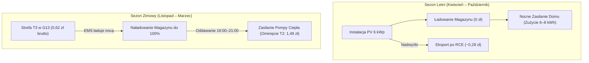
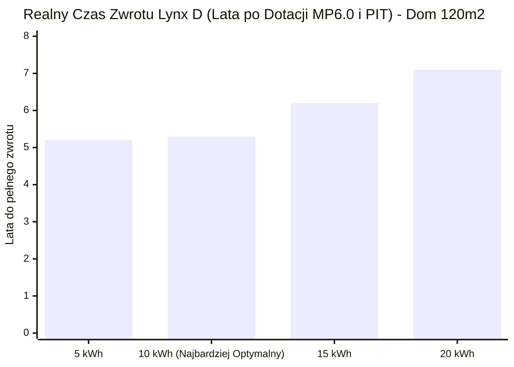

# Studium Przypadku: Dom 120 m² z Pompą Ciepła i PV 6 kWp BEZ Magazynu Energii oraz Analiza Opłacalności Inwestycji (ROI)

## Porównanie taryf bez baterii oraz kalkulacja zakupu GoodWe GW10K-ET + Lynx D (5–20 kWh) z programem Mój Prąd 6.0

**Dokument inżynieryjny i poradnik inwestycyjny dla sąsiadów oraz właścicieli domów jednorodzinnych 120 m² z pompą ciepła i mikroinstalacją PV 6 kWp.**  
*Status prawny i dotacyjny: Listopad 2026 r. (Program Mój Prąd 6.0, Ulga Termomodernizacyjna, Taryfy URE / RCE).*  
*100% zanonimizowane dane fizyczne, techniczne i rynkowe.*

---

## 1. Wstęp: Profil Energetyczny Domu 120 m² z Pompą Ciepła i PV 6 kWp

Dla domu o powierzchni **120 m²** (standard ocieplenia WT2017/WT2021, 3–4 mieszkańców, ogrzewanie podłogowe z pompą ciepła powietrze-woda o mocy 5–7 kW) oraz instalacją **PV 6 kWp**:

### Zapotrzebowanie i bilans energetyczny:
* **Zużycie pompy ciepła (c.o. + c.w.u.):** ~3 800 kWh / rok (z czego ~75% przypada na miesiące listopad–marzec).
* **Zużycie bytowe (AGD, RTV, oświetlenie, rekuperacja):** ~3 000 kWh / rok.
* **Łączne roczne zapotrzebowanie domu na prąd:** **6 800 kWh / rok**.
* **Roczna produkcja z instalacji PV 6 kWp:** **~6 000 kWh / rok** (~4 500 kWh w sezonie kwiecień–wrzesień, ~1 500 kWh w sezonie październik–marzec).

---

## 2. Benchmark Taryfowy w Domu 120 m² BEZ Magazynu Energii

Gdy w domu **NIE MA magazynu energii**:
1. **Niska autokonsumpcja PV:** W słoneczny dzień instalacja 6 kWp daje 4–5 kW mocy, a dom zużywa zaledwie 0,3–0,6 kW (gdy mieszkańcy są w pracy/szkole). Bez magazynu autokonsumpcja wynosi zaledwie **25%** (~1 500 kWh/rok).
2. **Eksport nadwyżek PV:** **4 500 kWh / rok** jest przymusowo oddawane do sieci po stawkach giełdowych RCE (depozyt prosumencki wynosi ~1 260 zł rocznie przy średniej cenie 0,28 zł/kWh netto).
3. **Pobór z sieci elektroenergetycznej (import netto):** **5 300 kWh / rok**.

### Zestawienie Kosztów Zakupu 5 300 kWh z Sieci (BEZ Magazynu Energii):

| Taryfa / Model | Charakterystyka Rozliczenia | Profil Poboru bez Baterii | Roczny Koszt Zakupu z Sieci [zł brutto] | Średni Koszt 1 kWh [zł] | Relacja do Lidera |
| :--- | :--- | :--- | :---: | :---: | :---: |
| **Tauron G12w** | 2-strefowa weekendowa | 45% szczyt (1,15 zł), 55% pozaszczyt + weekend (0,65 zł) | **4 637,50 zł** | **0,875 zł/kWh** | **NAJLEPSZA BEZ BATERII** |
| **Tauron G11** | 1-strefowa płaska | 100% płasko (0,95 zł/kWh całą dobę) | **5 035,00 zł** | **0,950 zł/kWh** | +397,50 zł (+8,6%) |
| **Tauron G13** | 3-strefowa (bez baterii wpada w drogi szczyt T2) | 30% T1 (0,90 zł), 35% T2 szczyt (1,49 zł), 35% T3 (0,62 zł) | **5 345,05 zł** | **1,008 zł/kWh** | +707,55 zł (+15,3%) |
| **Taryfa Dynamiczna (np. Pstryk)** | Rynkowa RCE + dystrybucja | Pobór zimowy pokrywa się ze szczytem cenowym giełdy (~1,25 zł śr.) | **6 625,00 zł** | **1,250 zł/kWh** | **+1 987,50 zł (+42,8% KATASTROFA)** |

### Wnioski dla domu bez baterii:
* **G13 bez magazynu jest pułapką:** Z powodu drogiego szczytu popołudniowego T2 (**1,49 zł/kWh** w godzinach 16:00–21:00 zimą), dom bez magazynu płaci w G13 o **708 zł więcej** niż w G12w!
* **G12w to jedyna racjonalna taryfa ratunkowa bez magazynu:** Weekendy po 0,65 zł i doliny nocne ratują budżet.
* **Taryfa dynamiczna generuje gigantyczną stratę:** Praca pompy ciepła w zimowe bezwietrzne wieczory po stawkach giełdowych 600–900 zł/MWh netto podbija roczny rachunek o niemal 2 000 zł.

---

## 3. Co Daje Magazyn Energii z Automatyzacją EMS w Domu 120 m²?

Magazyn energii odwraca tabelę taryfową – **pozwala przejść na taryfę G13 i zepchnąć niemal 95% poboru z sieci do najtańszej strefy T3 (0,62 zł/kWh)**.

1. **Wiosna – Lato:** Magazyn zatrzymuje nadwyżki z PV 6 kWp na noc. Nocne zapotrzebowanie domu 120 m² w lecie wynosi 6–8 kWh. Zatrzymanie energii w domu zamiast eksportu daje oszczędność **0,44 zł na każdej kWh**.
2. **Zima:** Algorytm EMS ładuje baterię z sieci w dolinie nocnej T3 (0,62 zł) i zasila pompę ciepła w szczycie T2 (1,49 zł). Netto zysk na arbitrażu wynosi **0,78 zł na każdej kWh**.

---

## 4. Architektura Sprzętowa: GoodWe GW10K-ET i Seria Lynx D

W odróżnieniu od klasycznych magazynów wieżowych (takich jak Lynx Home F czy Pylontech Force H2), w których na szczycie wieży wymagana jest osobna, kosztowna jednostka nadrzędna PCU/BMS, seria **GoodWe Lynx Home D (model LX D5.0-10)** charakteryzuje się nowoczesną architekturą **zintegrowaną**:

* **Każdy moduł LX D5.0-10 (5 kWh) posiada fabrycznie wbudowany układ BMS oraz wewnętrzny konwerter napięcia DC/DC (PCU).**
* Oznacza to, że moduł może pracować w pełni samodzielnie już jako pojedyncza jednostka (1x 5 kWh podłączona bezpośrednio do falownika hybrydowego pod złącza wysokonapięciowe 320–480V).
* Dodatkowym elementem instalacyjnym jest jedynie mechaniczna **podstawa podłogowa (Base)** lub uchwyt ścienny wraz z okablowaniem (koszt rynkowy zaledwie **~300–350 zł brutto**), a nie oddzielny elektroniczny moduł sterujący za kilka tysięcy złotych!

### Rzeczywisty Kosztorys Komponentów na Rynku:
1. **Falownik Hybrydowy GoodWe GW10K-ET-20 AFCI (3-fazowy):**  
   Cena zakupu: **~6 800 zł brutto** (ok. **8 000 zł z montażem**, zabezpieczeniami AC/DC i podłączeniem Backup UPS).
2. **Pojedynczy Moduł Bateryjny GoodWe LX D5.0-10 (5 kWh z wbudowanym BMS i PCU):**  
   Cena zakupu: **~5 900 – 6 300 zł brutto / moduł** (średnio **~6 200 zł brutto**).
3. **Podstawa montażowa (Base) / Wieszak z okablowaniem:**  
   Cena zakupu: **~350 zł brutto**.
4. **Montaż, podłączenie i uruchomienie instalatorskie:**  
   Od **1 000 zł** (dla 1 modułu) do **1 800 zł** (dla 4 modułów).

---

## 5. Zestawienie 4 Wariantów Pojemności dla Domu 120 m² i PV 6 kWp

| Parametr | 1× 5 kWh (1 moduł LX D5.0) | 2× 5 kWh = 10 kWh (2 moduły) | 3× 5 kWh = 15 kWh (3 moduły) | 4× 5 kWh = 20 kWh (4 moduły) |
| :--- | :---: | :---: | :---: | :---: |
| **Pojemność nominalna** | 5,0 kWh | 10,0 kWh | 15,0 kWh | 20,0 kWh |
| **Pojemność użyteczna (DoD 90%)** | 4,5 kWh | 9,0 kWh | 13,5 kWh | 18,0 kWh |
| **Dodatkowa autokonsumpcja PV/rok** | +750 kWh | +1 350 kWh | +1 500 kWh *(plateau)* | +1 550 kWh *(plateau)* |
| **Zimowy arbitraż taryfowy (T3 -> T2)** | 380 kWh | 720 kWh | 1 000 kWh | 1 250 kWh |
| **Roczna suma przesuniętej energii** | **1 130 kWh** | **2 070 kWh** | **2 500 kWh** | **2 800 kWh** |
| **Roczna oszczędność na rachunkach (G13 + EMS)** | **~630 zł / rok** | **~1 162 zł / rok** | **~1 448 zł / rok** | **~1 667 zł / rok** |

*Uwaga bilansowa:* W domu 120 m² nocne zużycie w lecie rzadko przekracza 7–8 kWh. Dlatego warianty 15 kWh i 20 kWh w lecie nie są w pełni rozładowywane przez noc, co ogranicza ich letnią autokonsumpcję (zjawisko nasycenia/plateau).

---

## 6. Programy Wsparcia: Mój Prąd 6.0 i Ulga Termomodernizacyjna

1. **Program Mój Prąd 6.0:** Dotacja do magazynu energii wynosi **50% kosztów kwalifikowanych**, maksymalnie **do 16 000 zł**. Wymóg: minimalna pojemność 2 kWh (każdy z 4 wariantów spełnia ten warunek).
2. **Ulga Termomodernizacyjna (PIT):** Kwotę wkładu własnego (po odliczeniu dotacji) odliczamy od podstawy opodatkowania. Przy I progu podatkowym (12%) daje to **12% zwrotu włożonej gotówki**.

---

## 7. Rzeczywisty Kosztorys Inwestycji i Czas Zwrotu (ROI)

### SCENARIUSZ A: Rozbudowa (Inwestor posiada kompatybilny falownik hybrydowy)
*Zakup samego magazynu GoodWe Lynx D (moduły LX D5.0 z wbudowanym BMS + podstawa + montaż).*

| Pozycja | Wariant 1: 5 kWh (1 moduł) | Wariant 2: 10 kWh (2 moduły) | Wariant 3: 15 kWh (3 moduły) | Wariant 4: 20 kWh (4 moduły) |
| :--- | :---: | :---: | :---: | :---: |
| **Koszt zestawu brutto z montażem** | **7 500 zł** | **14 000 zł** | **20 500 zł** | **27 000 zł** |
| **Dotacja Mój Prąd 6.0 (50% do 16 tys. zł)** | -3 750 zł | -7 000 zł | -10 250 zł | -13 500 zł |
| **Wkład własny po dotacji** | 3 750 zł | 7 000 zł | 10 250 zł | 13 500 zł |
| **Zwrot z Ulgi PIT (12%)** | -450 zł | -840 zł | -1 230 zł | -1 620 zł |
| **REALNY KOSZT Z KIESZENI INWESTORA** | **3 300 zł** | **6 160 zł** | **9 020 zł** | **11 880 zł** |
| **Roczna oszczędność finansowa** | 630 zł/rok | 1 162 zł/rok | 1 448 zł/rok | 1 667 zł/rok |
| **Czas zwrotu bez dotacji** | 11,9 lat | 12,0 lat | 14,2 lat | 16,2 lat |
| **REALNY CZAS ZWROTU (Dotacja + PIT)** | **5,2 lat** | **5,3 lat (SWEET SPOT)** | **6,2 lat** | **7,1 lat** |

---

### SCENARIUSZ B: Inwestycja Kompleksowa (Wymiana falownika On-Grid na Hybrydowy GW10K-ET + Magazyn Lynx D)
*Dla sąsiadów posiadających tradycyjny falownik sieciowy (+8 000 zł brutto za falownik hybrydowy z profesjonalnym montażem i zabezpieczeniami).*

| Pozycja | 5 kWh + GW10K-ET | 10 kWh + GW10K-ET | 15 kWh + GW10K-ET | 20 kWh + GW10K-ET |
| :--- | :---: | :---: | :---: | :---: |
| **Koszt całości brutto z montażem** | 15 500 zł | 22 000 zł | 28 500 zł | 35 000 zł |
| **Dotacja MP6.0 do magazynu** | -3 750 zł | -7 000 zł | -10 250 zł | -13 500 zł |
| **Wkład po dotacji** | 11 750 zł | 15 000 zł | 18 250 zł | 21 500 zł |
| **Ulga Termomodernizacyjna (PIT 12%)** | -1 410 zł | -1 800 zł | -2 190 zł | -2 580 zł |
| **REALNY KOSZT INWESTORA** | **10 340 zł** | **13 200 zł** | **16 060 zł** | **18 920 zł** |
| **Roczna oszczędność** | 630 zł/rok | 1 162 zł/rok | 1 448 zł/rok | 1 667 zł/rok |
| **REALNY CZAS ZWROTU (Z nowym falownikiem)** | **16,4 lat** | **11,4 lat** | **11,1 lat** | **11,3 lat** |
| **Czas zwrotu po odsprzedaży starego on-grid (~2 500 zł)** | **12,4 lat** | **9,2 lat** | **9,4 lat** | **9,9 lat** |

---

## 8. Werdykt i Rekomendacja Inżynierska dla Domu 120 m² i PV 6 kWp

Dla metrażu **120 m²** i mikroinstalacji fotowoltaicznej **6 kWp**:

### 1. Zwycięzca ekonomiczny i techniczny: Wariant 10 kWh (2 moduły GoodWe Lynx D)
* **Dlaczego:**  
  Dzięki zintegrowanej architekturze Lynx D koszt 2 modułów z podstawą i montażem to zaledwie **14 000 zł brutto**.  
  Po dotacji Mój Prąd 6.0 i uldze podatkowej realny wydatek z kieszeni inwestora to **tylko 6 160 zł**!  
  Czas zwrotu wynosi rewelacyjne **5,3 roku** przy 10-letniej gwarancji na baterię.  
  Pojemność użyteczna 9,0 kWh w 100% zamyka letnią noc (6–8 kWh) oraz cały 5-godzinny zimowy szczyt T2 w taryfie G13 (16:00–21:00) dla pompy ciepła i domu.

### 2. Opcja rozszerzona (dla pasjonatów bezpieczeństwa i Back-up): Wariant 15 kWh (3 moduły)
* Dopłata do 3 modułu to niecałe **2 860 zł netto z kieszeni**.
* Czas zwrotu wydłuża się nieznacznie do **6,2 roku**.
* Warto rozważyć, jeśli sąsiad chce mieć 13,5 kWh rezerwy zasilania awaryjnego (UPS na wypadek awarii sieci w zimie) lub planuje dokupić auto elektryczne / dołożyć paneli.

### 3. Warianty niezalecane:
* **5 kWh (1 moduł):** Choć kosztuje po dotacji zaledwie 3 300 zł i zwraca się w 5,2 roku, to zimą 4,5 kWh użytecznej pojemności rozładuje się po 2,5 godzinach szczytu T2, zmuszając dom do zakupu prądu po 1,49 zł/kWh przez resztę popołudnia.
* **20 kWh (4 moduły):** Przewymiarowany. W lecie dom 120 m² nie jest w stanie rozładować 18 kWh przez noc, przez co zwrot wydłuża się do ponad 7 lat (i 10 lat z falownikiem).
