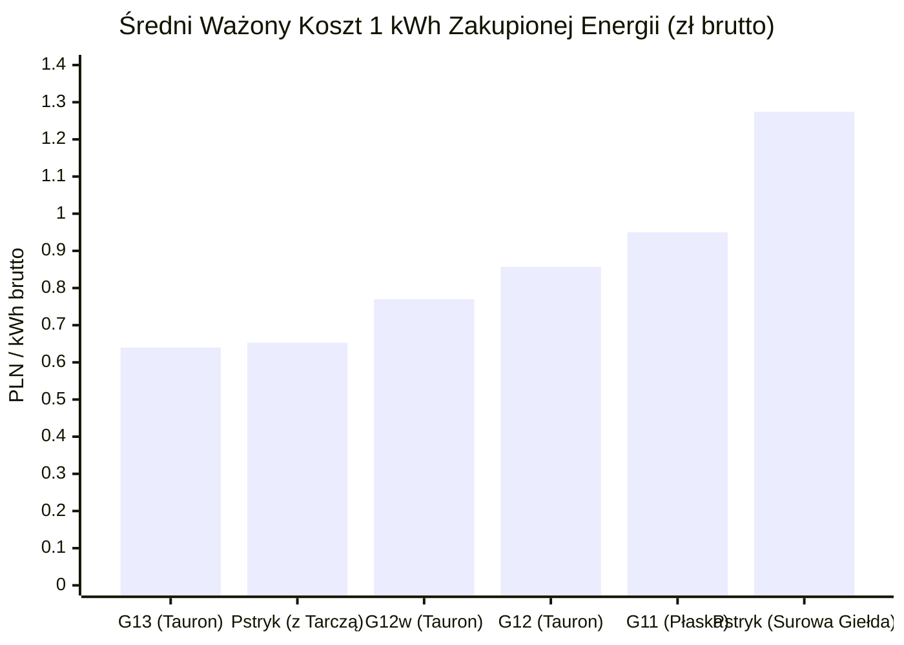

# Studium Przypadku: 3 546-godzinny Benchmark Taryf w Domu z Pompą Ciepła
## Empiryczne porównanie taryf: G11 vs G12 vs G12w vs G13 vs Taryfa Dynamiczna (Pstryk)

[🇬🇧 English](CASE_STUDY_TARIFF_BENCHMARK_G13_VS_DYNAMIC_EN.md) | **🇵🇱 Polski**

* **Dokument inżynieryjny dla użytkowników Smart Storage EMS.**  
* Prezentuje wyniki 5-miesięcznego badania ciągłego (1 lipca – 26 listopada 2026 r., 3 546 godzin zegarowych) na rzeczywistych danych pomiarowych z licznika domowego oraz oficjalnych notowań rynkowych (PSE S.A. / TGE).
* 100% zanonimizowane dane fizyczne i rynkowe, zgodne z Art. 4 ust. 2b Ustawy o OZE (bilansowanie godzinowe OSD).

---

## 1. Tabela Ligowa Taryf (Wynik 5-miesięcznego Benchmarku)

Na identycznym zbiorze 3 546 rzeczywistych godzin zarejestrowanych przez licznik domowy GoodWe, po przeprowadzeniu ustawowego godzinowego bilansowania wektorowego, uzyskano następujące koszty zakupu energii (łącznie **977,73 kWh netto** poboru z sieci):

| Miejsce | Taryfa / Model | Typ Rozliczenia | Koszt Zakupu [zł] | Średni Ważony Koszt 1 kWh | Różnica Kwotowa do G13 [zł] | Relacja do Lidera |
| :---: | :--- | :--- | :---: | :---: | :---: | :---: |
| **1.** | **Tauron G13** | 3-strefowa z doliną popołudniową i nocną | **625,90 zł** | **0,640 zł/kWh** | **0,00 zł** | **LIDER REGULOWANY** |
| **2.** | **Pstryk (z Tarczą)** | Dynamiczna z komercyjną Tarczą Pstryk (max 0,61 zł brutto za energię) | **638,40 zł** | **0,653 zł/kWh** | **+12,50 zł** | **REMIS / BLISKI LIDER (+2,0%)** |
| **3.** | **Tauron G12w** | 2-strefowa weekendowa (dzień / noc + weekend) | **753,24 zł** | **0,770 zł/kWh** | **+127,34 zł** | +20,3% drożej |
| **4.** | **Tauron G12** | 2-strefowa klasyczna (dzień / noc bez weekendów) | **837,99 zł** | **0,857 zł/kWh** | **+212,09 zł** | +33,9% drożej |
| **5.** | **Tauron G11** | 1-strefowa płaska (całodobowa) | **928,84 zł** | **0,950 zł/kWh** | **+302,94 zł** | +48,4% drożej |
| **6.** | **Pstryk (Giełda Surowa)** | Czysta cena giełdowa RDN/RCE bez mechanizmu ochronnego Tarczy | **1 245,40 zł** | **1,274 zł/kWh** | **+619,50 zł** | +99,0% drożej (Ekspozycja na Dunkelflaute) |

### Kluczowy Wniosek: Rola „Tarczy Pstryk” jako Bezpiecznika
Porównanie ujawnia fundamentalną zależność:
* **Pstryk z komercyjną „Tarczą Pstryk”:** Stanowi realną alternatywę dla taryfy G13. Dzięki gwarancji, że średniomiesięczny koszt energii czynnej nie przekroczy poziomu **0,61 zł/kWh brutto**, listopadowe skoki giełdowe są skutecznie obcinane, a rachunek końcowy (**638,40 zł**) różni się od lidera G13 (**625,90 zł**) o zaledwie **12,50 zł w skali 5 miesięcy**.
* **Pstryk na czystej giełdzie (bez Tarczy):** Obnaża ogromne ryzyko ekspozycji na zimowe skoki cenowe RDN/RCE (*Dunkelflaute*). W samym listopadzie niechroniona giełda wygenerowała **848,13 zł** kosztu zakupu energii.

---

## 2. Metodologia Rozliczeniowa i Podstawa Prawna

### 2.1. Ustawowe Bilansowanie Godzinowe Wektorowe
Zgodnie z **Art. 4 ust. 2b Ustawy z dnia 20 lutego 2015 r. o odnawialnych źródłach energii**, Operator Systemu Dystrybucyjnego (Tauron Dystrybucja) przeprowadza bilansowanie energii wprowadzonej i pobranej w ramach każdej godziny zegarowej:

$$E_{\mathrm{net,imp}, h} = \max\left(0,\, E_{\mathrm{imp}, h} - E_{\mathrm{exp}, h}\right)$$
$$E_{\mathrm{net,exp}, h} = \max\left(0,\, E_{\mathrm{exp}, h} - E_{\mathrm{imp}, h}\right)$$

*Uwaga metodologiczna:* Zarówno w Tauronie, jak i w Pstryku, dane pomiarowe do rozliczenia pochodzą z tego samego fizycznego licznika OSD. Sprzedawca otrzymuje od OSD wartości już zbilansowane ($E_{\mathrm{net,imp}}$ oraz $E_{\mathrm{net,exp}}$). Bilansowanie godzinowe traktuje oba portfele w identyczny sposób.

### 2.2. Precyzyjne Składowe Kosztów Taryf Regulowanych (URE / Tauron)
Wszystkie stawki bazują na oficjalnych taryfach zatwierdzonych przez Prezesa URE z uwzględnieniem ustawy o ochronie odbiorców energii (cena maksymalna energii czynnej 500 zł/MWh netto = 0,50 zł/kWh netto = 0,615 zł/kWh brutto):
* **Stawka jakościowa:** ok. 0,0259 zł/kWh netto (0,0319 zł brutto)
* **Opłata OZE + Kogeneracyjna:** ok. 0,0115 zł/kWh netto (0,0141 zł brutto)
* **Taryfa G11:** Płaska stawka całodobowa **0,95 zł/kWh brutto**.
* **Taryfa G12:** Szczyt (06:00–13:00, 15:00–22:00) **1,15 zł/kWh brutto**; Pozaszczyt **0,65 zł/kWh brutto**.
* **Taryfa G12w:** Szczyt roboczy **1,15 zł/kWh brutto**; Pozaszczyt roboczy oraz całe weekendy i święta **0,65 zł/kWh brutto**.
* **Taryfa G13:** T1 (07:00–13:00) **0,90 zł/kWh**; T2 (16:00–21:00 zima) **1,49 zł/kWh**; T3 (13:00–16:00, 21:00–07:00 oraz weekendy/święta) **0,62 zł/kWh brutto**.

### 2.3. Model Taryfy Dynamicznej Pstryk i Dystrybucja
* **Energia czynna na giełdzie:** Średnia arytmetyczna z 4 kwadransów stawki giełdowej (TGE RDN Fixing I / RCE publikowane przez PSE S.A. – korelacja obu indeksów w badanym okresie wynosi ponad 97%).
* **Marża Pstryka:** Stała prowizja **0,08 zł/kWh netto** (0,0984 zł brutto).
* **VAT:** 23%.
* **Dystrybucja OSD:** Użytkownik Pstryka pozostaje przyłączony do sieci Tauron Dystrybucja i korzysta z taryfy dystrybucyjnej dopasowanej do profilu (w badaniu przyjęto dystrybucję **G13**, gdzie zmienna stawka sieciowa w dolinie nocnej T3 wynosi symboliczne **~0,005 zł/kWh**).
  $$C_{\mathrm{Pstryk, surowy}}(h) = \left(RCE_h + 0,08\right) \times 1,23 + D_{\mathrm{G13}}(h)$$

### 2.4. Mechanizm Promocyjny „Tarcza Pstryk”
W wariancie ochronnym sprzedawca energii (Pstryk) stosuje miesięczny mechanizm bezpiecznika (*Tarcza Pstryk*):
* Średnia ważona cena samej energii czynnej powiększonej o opłatę za obsługę nie może w cyklu miesięcznym przekroczyć **0,61 zł/kWh brutto** (odpowiednik 0,50 zł/kWh netto).
* Jeśli rynkowe ceny giełdowe w danym miesiącu podniosą średnią ważoną powyżej 0,61 zł/kWh, sprzedawca udziela opustu kompensującego nadwyżkę. Opłaty dystrybucyjne OSD rozliczane są niezależnie.
  $$C_{\mathrm{Pstryk, Tarcza}}(miesiąc) = \min\left(\overline{C}_{\mathrm{energia, surowa}},\, 0,61\text{ zł}\right) \times E_{\mathrm{net,imp}} + \sum D_{\mathrm{G13}}(h)$$

### 2.5. Wycena Eksportu Energii (Depozyt Prosumencki)
Wycena nadwyżki energii oddanej do sieci ($E_{\mathrm{net,exp}, h}$) po zbilansowaniu godzinowym rozliczana jest po stawce rynkowej $RCE_h$:
$$W_{\mathrm{depozyt}}(h) = E_{\mathrm{net,exp}, h} \times RCE_h$$
Wartość depozytu w badanym okresie wyniosła dokładnie **514,05 zł** i jest identyczna dla wszystkich taryf.

---

## 3. Szczegółowe Wyniki Miesięczne Wszystkich Taryf

Pełne zestawienie kosztów zakupu netto miesiąc po miesiącu:

| Miesiąc | Wolumen Netto [kWh] | G13 [zł] | Pstryk (z Tarczą) [zł] | G12w [zł] | G12 [zł] | G11 [zł] | Pstryk (Giełda Surowa) [zł] | Lider Miesiąca |
| :--- | :---: | :---: | :---: | :---: | :---: | :---: | :---: | :---: |
| **Lipiec 2026** | 8,8 kWh | **5,82 zł** | 7,39 zł | 6,84 zł | 7,09 zł | 8,38 zł | 7,39 zł | **G13** |
| **Sierpień 2026** | 19,1 kWh | **12,18 zł** | 15,59 zł | 15,28 zł | 15,53 zł | 18,15 zł | 15,59 zł | **G13** |
| **Wrzesień 2026** | 108,7 kWh | 71,80 zł | **68,20 zł** | 92,87 zł | 96,45 zł | 103,27 zł | 125,02 zł | **Pstryk (Tarcza)** |
| **Październik 2026** | 225,9 kWh | 147,42 zł | **143,50 zł** | 178,46 zł | 201,06 zł | 214,61 zł | 249,25 zł | **Pstryk (Tarcza)** |
| **Listopad 2026** *(do 26.11)* | 615,2 kWh | **388,68 zł** | 403,72 zł | 459,79 zł | 517,87 zł | 584,45 zł | 848,13 zł | **G13** |
| **RAZEM** | **977,73 kWh** | **625,90 zł** | **638,40 zł** | **753,24 zł** | **837,99 zł** | **928,84 zł** | **1 245,40 zł** | **G13 (Minimalna przewaga)** |

---

## 4. Analiza Porównawcza: G13 vs Pstryk z Tarczą vs Surowa Giełda

1. **G13 vs Pstryk z Tarczą (Różnica zaledwie 12,50 zł na korzyść G13):**
   * Przy aktywnej Tarczy Pstryk dynamiczna taryfa staje się bardzo konkurencyjna wobec G13.
   * W miesiącach przejściowych (wrzesień, październik), gdy ceny nocne na giełdzie bywają niskie, Pstryk z Tarczą był minimalnie tańszy od G13 (o ~3–4 zł miesięcznie).
   * W listopadzie Tarcza ścięła koszt energii czynnej do 0,61 zł brutto, co przy dystrybucji G13 T3 dało koszt 403,72 zł wobec 388,68 zł w taryfie G13. Różnica w skali całego okresu wynosi zaledwie 2%.

2. **G13 / Pstryk Tarcza vs G12w i G11:**
   * Obie czołowe opcje (G13 i Pstryk z Tarczą) deklasują tradycyjne taryfy G12w (+127 zł drożej) i G11 (+303 zł drożej).
   * Zepchnięcie poboru do doliny nocnej i popołudniowej przy wsparciu magazynu energii daje kluczową przewagę ekonomiczną.

3. **Zagrożenie Surowej Giełdy (Bez Tarczy):**
   * Wyłączenie Tarczy ochronnej winduje koszt Pstryka do **1 245,40 zł** (+619,50 zł straty).
   * W domu z pompą ciepła profil zapotrzebowania przypada na okresy najwyższych cen giełdowych w KSE (zimowe popołudnia i bezwietrzne noce), gdy ceny hurtowe przekraczają 600–850 zł/MWh.

---

## 5. Elastyczność Popytu i Model Aktywnego Przesunięcia Profilu (Active Shifting)

Aby sprawdzić, czy sterowanie dynamiczne (ładowanie w najtańszych godzinach giełdowych danej doby) pozwala pobić taryfę G13, przeliczono scenariusz **Best-Case Active Shifting**:
* Algorytm EMS przesuwa 100% dobowego poboru netto do **6 najtańszych godzin danej doby**:

| Miesiąc | Pobór Netto [kWh] | G13 Rzeczywisty [zł] | Pstryk (z Tarczą) [zł] | Pstryk: Aktywny 6h (Surowy) [zł] | Pstryk: Pasywny (Surowy) [zł] |
| :--- | :---: | :---: | :---: | :---: | :---: |
| **Lipiec 2026** | 8,8 kWh | **5,82 zł** | 7,39 zł | 6,28 zł | 7,39 zł |
| **Sierpień 2026** | 19,1 kWh | 12,18 zł | 15,59 zł | **11,76 zł** | 15,59 zł |
| **Wrzesień 2026** | 108,7 kWh | 71,80 zł | **68,20 zł** | 119,39 zł | 125,02 zł |
| **Październik 2026** | 225,9 kWh | 147,42 zł | **143,50 zł** | 254,68 zł | 249,25 zł |
| **Listopad 2026** | 615,2 kWh | **388,68 zł** | 403,72 zł | 769,59 zł | 848,13 zł |
| **RAZEM** | **977,73 kWh** | **625,90 zł** | **638,40 zł** | **1 161,69 zł** | **1 245,40 zł** |

### Wnioski z analizy przesunięcia:
* Na samej giełdzie zimą nawet najtańsze 6 godzin doby kosztowało w listopadzie średnio ponad 520 zł/MWh netto (>1,09 zł/kWh brutto z marżą i VAT).
* Dlatego bez mechanizmu Tarczy samo aktywne przesuwanie profilu nie wystarcza do pokonania sztywnej doliny T3 w G13 (0,62 zł). To **Tarcza Pstryk**, a nie sam dołek giełdowy, stanowi klucz do opłacalności tego rozwiązania w zimie.

---

## 6. Perspektywa Całorocznego Bilansu Finansowego i Depozytu Prosumenckiego

Częstym argumentem zwolenników taryfy dynamicznej jest całościowy bilans roczny:
*„Przy odpowiednio dużej instalacji PV latem sprzedajemy prąd po wysokich cenach i kumulujemy duży depozyt, schodząc z rachunkami rocznymi do zera.”*

### Realia bilansu dla domu z pompą ciepła:
1. **Wycena eksportu w net-billingu:** Zgodnie z ustawą o OZE eksport energii do depozytu prosumenckiego wyceniany jest po stawce rynkowej $RCE$ **niezależnie od tego, czy mamy umowę z operatorem zasiedziałym (Tauron), czy ze sprzedawcą dynamicznym (Pstryk)**. W obu przypadkach depozyt buduje się w ten sam sposób.
2. **Dopasowanie instalacji PV:**  
   * W domu z dużą instalacją PV (>10–12 kWp) i relatywnie małym zużyciem zimowym letni depozyt z nawiązką pokrywa zimowe koszty zakupu, czyniąc różnice między G13 a Pstrykiem drugorzędnymi.
   * W domach o mniejszym stosunku PV do zużycia (np. PV 6 kWp i dom 120 m² z pompą ciepła zużywający 6 800 kWh rocznie) zimowy pobór jest na tyle wysoki, że precyzyjna kontrola kosztu 1 kWh zakupu w sezonie grzewczym ma kluczowe znaczenie.

---

## 7. Podsumowanie i Werdykt Strategiczny

* **Tauron G13 (625,90 zł):** Najstabilniejszy wybór inżynieryjny, dający gwarantowaną, zabetonowaną stawkę 0,62 zł/kWh brutto w długich dolinach nocnych i popołudniowych, w 100% chroniony ustawową tarczą regulowaną.
* **Pstryk z Tarczą (638,40 zł):** Równorzędny, bardzo dobry wybór dla entuzjastów dynamicznego rynku. Komercyjna Tarcza (limit 0,61 zł brutto za energię czynną) eliminuje ryzyko zimowej katastrofy cenowej, dając szansę na niższe rachunki w miesiącach z tanią generacją OZE.
* **Pstryk bez Tarczy (1 245,40 zł):** Skrajnie ryzykowny dla domów z pompą ciepła. Brak ograniczenia cenowego w sezonie zimowym prowadzi do podwojenia kosztów zakupu prądu.
* **Werdykt:**  
  * Jeśli cenisz **spokój regulacyjny i przewidywalność** -> **Tauron G13**.  
  * Jeśli korzystasz z Pstryka -> **bezwzględnie pilnuj aktywności Tarczy Pstryk** i utrzymuj umowę dystrybucyjną w grupie wielostrefowej (G13/G12w).
