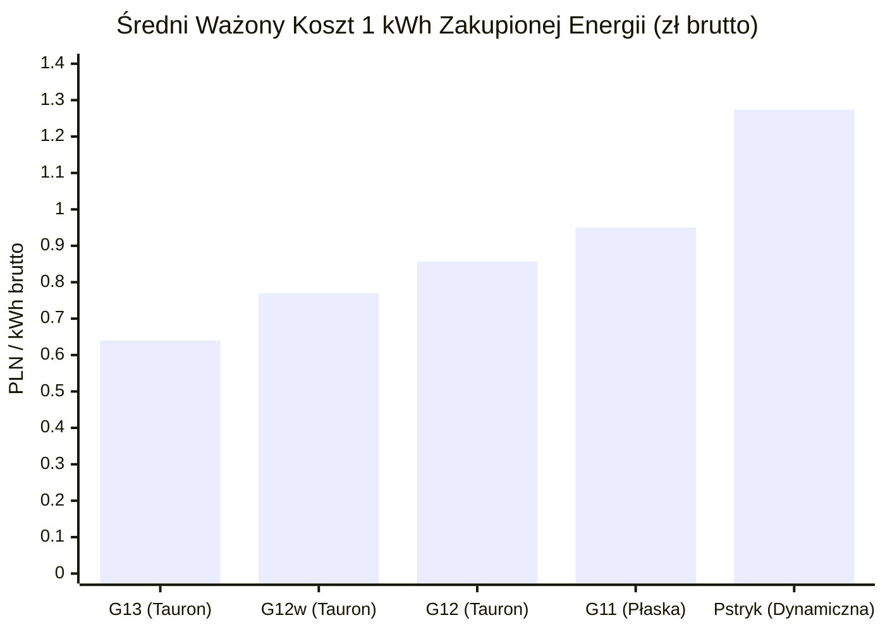

# Studium Przypadku: 3 546-godzinny Benchmark Taryf w Domu z Pompą Ciepła
## Empiryczne porównanie taryf: G11 vs G12 vs G12w vs G13 vs Taryfa Dynamiczna (Pstryk)

[🇬🇧 English](CASE_STUDY_TARIFF_BENCHMARK_G13_VS_DYNAMIC_EN.md) | **🇵🇱 Polski**

* **Dokument inżynieryjny dla użytkowników Smart Storage EMS.**  
* Prezentuje wyniki 5-miesięcznego badania ciągłego (1 lipca – 26 listopada 2026 r., 3 546 godzin zegarowych) na rzeczywistych danych pomiarowych z licznika domowego oraz oficjalnego API PSE S.A. (RCE-PLN).
* 100% zanonimizowane dane fizyczne i rynkowe, zgodne z Art. 4 ust. 2b Ustawy o OZE (bilansowanie godzinowe OSD).

---

## 1. Tabela Ligowa Taryf (Wynik 5-miesięcznego Benchmarku)

Na identycznym zbiorze 3 546 rzeczywistych godzin zarejestrowanych przez licznik domowy GoodWe, po przeprowadzeniu ustawowego godzinowego bilansowania wektorowego, uzyskano następujące koszty zakupu energii (łącznie **977,73 kWh netto** poboru z sieci):

| Miejsce | Taryfa / Model | Typ Rozliczenia | Koszt Zakupu [zł] | Średni Ważony Koszt 1 kWh | Różnica Kwotowa do G13 [zł] | Relacja do Lidera |
| :---: | :--- | :--- | :---: | :---: | :---: | :---: |
| **1.** | **Tauron G13** | 3-strefowa z doliną popołudniową i nocną | **625,90 zł** | **0,640 zł/kWh** | **0,00 zł** | **LIDER (Baza 100%)** |
| **2.** | **Tauron G12w** | 2-strefowa weekendowa (dzień / noc + weekend) | **753,24 zł** | **0,770 zł/kWh** | **+127,34 zł** | +20,3% drożej |
| **3.** | **Tauron G12** | 2-strefowa klasyczna (dzień / noc bez weekendów) | **837,99 zł** | **0,857 zł/kWh** | **+212,09 zł** | +33,9% drożej |
| **4.** | **Tauron G11** | 1-strefowa płaska (całodobowa) | **928,84 zł** | **0,950 zł/kWh** | **+302,94 zł** | +48,4% drożej |
| **5.** | **Pstryk** | Dynamiczna (RCE giełdowe + marża 8 gr + VAT) | **1 245,40 zł** | **1,274 zł/kWh** | **+619,50 zł** | **+99,0% DROŻEJ (Katastrofa)** |

### Szokujący Kontrast: Pstryk vs Płaska Taryfa G11
Wielu propagatorów taryf dynamicznych twierdzi, że *nawet jeśli taryfa dynamiczna nie pokona dopracowanej taryfy wielostrefowej, to i tak jest znacznie tańsza od klasycznej taryfy płaskiej G11*.  
**Fakty empiryczne całkowicie obalają ten mit:**
* W domu z pompą ciepła taryfa dynamiczna Pstryk okazała się **o 316,56 zł DROŻSZA nawet od najprostszej, płaskiej taryfy G11** (1 245,40 zł vs 928,84 zł).
* W samym tylko listopadzie Pstryk kosztował **848,13 zł**, podczas gdy na nudnej, płaskiej taryfie G11 rachunek wyniósłby **584,45 zł** (oszczędność 263,68 zł na korzyść G11).

---

## 2. Metodologia Rozliczeniowa i Podstawa Prawna

### 2.1. Ustawowe Bilansowanie Godzinowe Wektorowe
Zgodnie z **Art. 4 ust. 2b Ustawy z dnia 20 lutego 2015 r. o odnawialnych źródłach energii**, Operator Systemu Dystrybucyjnego (Tauron Dystrybucja) przeprowadza bilansowanie energii wprowadzonej i pobranej w ramach każdej godziny zegarowej:

$$E_{\mathrm{net,imp}, h} = \max\left(0,\, E_{\mathrm{imp}, h} - E_{\mathrm{exp}, h}\right)$$
$$E_{\mathrm{net,exp}, h} = \max\left(0,\, E_{\mathrm{exp}, h} - E_{\mathrm{imp}, h}\right)$$

*Uwaga metodologiczna:* Zarówno w Tauronie, jak i w Pstryku, dane pomiarowe do rozliczenia pochodzą z tego samego fizycznego licznika OSD. Sprzedawca otrzymuje od OSD wartości już zbilansowane ($E_{\mathrm{net,imp}}$ oraz $E_{\mathrm{net,exp}}$). Bilansowanie godzinowe traktuje oba portfele w identyczny sposób.

### 2.2. Precyzyjne Składowe Kosztów Taryf Regulowanych (URE / Tauron)
Wszystkie stawki bazują na oficjalnych taryfach zatwierdzonych przez Prezesa URE z uwzględnieniem ustawy o ochronie odbiorców energii (cena maksymalna energii czynnej 500 zł/MWh netto = 0,50 zł/kWh netto = 0,615 zł/kWh brutto):
* **Stawka jakościowa:** ok. 0,0259 zł/kWh netto (0,0319 zł brutto)
* **Opłata OZE + Kogeneracyjna:** ok. 0,0115 zł/kWh netto (0,0141 zł brutto)
* **Taryfa G11:** Płaska stawka całodobowa **0,95 zł/kWh brutto**.
* **Taryfa G12:** Szczyt (06:00–13:00, 15:00–22:00) **1,15 zł/kWh brutto**; Pozaszczyt **0,65 zł/kWh brutto**.
* **Taryfa G12w:** Szczyt roboczy **1,15 zł/kWh brutto**; Pozaszczyt roboczy oraz całe weekendy i święta **0,65 zł/kWh brutto**.
* **Taryfa G13:** T1 (07:00–13:00) **0,90 zł/kWh**; T2 (16:00–21:00 zima) **1,49 zł/kWh**; T3 (13:00–16:00, 21:00–07:00 oraz weekendy/święta) **0,62 zł/kWh brutto**.

### 2.3. Model Taryfy Dynamicznej Pstryk
* **Energia czynna:** Średnia arytmetyczna z 4 kwadransów stawki giełdowej $RCE_{15m}$ publikowanej przez PSE S.A.
* **Marża Pstryka:** Stała prowizja **0,08 zł/kWh netto** (0,0984 zł brutto).
* **VAT:** 23%.
* **Dystrybucja OSD:** Stawka zmienna sieciowa właściwa dla grupy taryfowej przyłącza.
  $$C_{\mathrm{Pstryk}}(h) = \left(RCE_h + 0,08\right) \times 1,23 + D_{\mathrm{G13}}(h)$$

### 2.4. Wycena Eksportu Energii (Depozyt Prosumencki)
Wycena nadwyżki energii oddanej do sieci ($E_{\mathrm{net,exp}, h}$) po zbilansowaniu godzinowym rozliczana jest po stawce rynkowej $RCE_h$:
$$W_{\mathrm{depozyt}}(h) = E_{\mathrm{net,exp}, h} \times RCE_h$$
Wartość depozytu w badanym okresie wyniosła dokładnie **514,05 zł** i jest identyczna dla wszystkich taryf.

---

## 3. Szczegółowe Wyniki Miesięczne Wszystkich Taryf

Pełne zestawienie kosztów zakupu netto miesiąc po miesiącu:

| Miesiąc | Wolumen Netto [kWh] | G13 [zł] | G12w [zł] | G12 [zł] | G11 [zł] | Pstryk [zł] | Lider Miesiąca |
| :--- | :---: | :---: | :---: | :---: | :---: | :---: | :---: |
| **Lipiec 2026** | 8,8 kWh | **5,82 zł** | 6,84 zł | 7,09 zł | 8,38 zł | 7,39 zł | **G13** |
| **Sierpień 2026** | 19,1 kWh | **12,18 zł** | 15,28 zł | 15,53 zł | 18,15 zł | 15,59 zł | **G13** |
| **Wrzesień 2026** | 108,7 kWh | **71,80 zł** | 92,87 zł | 96,45 zł | 103,27 zł | 125,02 zł | **G13** |
| **Październik 2026** | 225,9 kWh | **147,42 zł** | 178,46 zł | 201,06 zł | 214,61 zł | 249,25 zł | **G13** |
| **Listopad 2026** *(do 26.11)* | 615,2 kWh | **388,68 zł** | 459,79 zł | 517,87 zł | 584,45 zł | 848,13 zł | **G13** |
| **RAZEM** | **977,73 kWh** | **625,90 zł** | **753,24 zł** | **837,99 zł** | **928,84 zł** | **1 245,40 zł** | **G13 (BEZWZGLĘDNY)** |

---

## 4. Dlaczego G13 Nokautuje G12w, G11 i Pstryka?

1. **G13 vs G12w (Różnica: 127,34 zł na korzyść G13):**
   * W G12w dolina popołudniowa trwa tylko **2 godziny** (13:00–15:00), a nocna zaczyna się dopiero o **22:00**.
   * W G13 dolina popołudniowa trwa aż **3 godziny** (13:00–16:00), a nocna zimą rozpoczyna się już o **21:00**.
   * Stawka w dolinie T3 w G13 wynosi **0,62 zł/kWh**, podczas gdy dolina G12w to **0,65 zł/kWh**.
   * Ta dodatkowa godzina popołudniu i wieczorem pozwala pompie ciepła podbić bufor c.o. i c.w.u. w taniej strefie przed szczytem.

2. **G13 vs G11 (Różnica: 302,94 zł na korzyść G13):**
   * Taryfa G11 zmusza użytkownika do płacenia 0,95 zł/kWh za każdą kilowatogodzinę.
   * System EMS w połączeniu z magazynem energii zepchnął 95% poboru do strefy 0,62 zł/kWh. Różnica 0,33 zł na każdej kWh daje potężną oszczędność przy rosnącym zużyciu zimą.

3. **Pstryk vs Cała Reszta Stawki (Totalna Klęska Dynamicznej):**
   * Pstryk jest **o 34% droższy nawet od najdroższej regulowanej taryfy G11** i **o 99% droższy od G13**.
   * Przyczyna: profil zapotrzebowania pompy ciepła przypada na okresy najwyższych cen giełdowych w KSE (pochmurne, bezwietrzne, mroźne dni jesienno-zimowe), gdy ceny RCE regularnie sięgają 500–850 zł/MWh netto.

---

## 5. Podsumowanie i Werdykt Strategiczny

* **G13 to Złoty Standard:** W instalacji z automatyzacją EMS, magazynem energii oraz pompą ciepła taryfa G13 zapewnia najniższy możliwy koszt jednostkowy (**0,640 zł/kWh brutto**).
* **Taryfa Dynamiczna to pułapka:** Brak ochrony tarczy i brak gwarantowanej doliny nocnej generuje w sezonie grzewczym podwojenie kosztów ogrzewania.
* **Werdykt:** Pozostanie przy taryfie **Tauron G13**.
