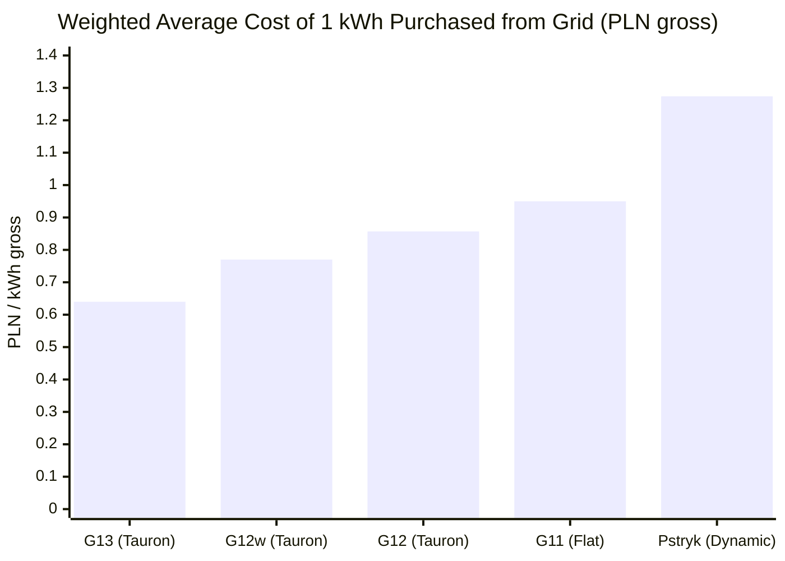

# Case Study: 3,546-Hour Electricity Tariff Benchmark in a Heat Pump Home
## Empirical Tariff Comparison: G11 vs G12 vs G12w vs G13 vs Dynamic Tariff (Pstryk)

**🇬🇧 English** | [🇵🇱 Polski](CASE_STUDY_TARIFF_BENCHMARK_G13_VS_DYNAMIC.md)

* **Engineering reference for Smart Storage EMS users.**  
* Documents the results of a 5-month continuous study (July 1 – November 26, 2026, 3,546 clock hours) using real physical telemetry from a residential smart meter and official wholesale pricing from PSE S.A. (RCE-PLN).
* 100% anonymized operational and market data, compliant with Art. 4 sec. 2b of the Polish Renewable Energy Act (hourly vector net balancing).

---

## 1. Tariff League Table (5-Month Benchmark Results)

Across the exact same dataset of 3,546 real operational hours recorded by a GoodWe smart meter, following statutory hourly vector net-metering, the total electricity purchase costs were calculated (**977.73 kWh net grid import**):

| Rank | Tariff / Model | Schedule Structure | Total Purchase Cost [PLN] | Weighted Average Cost / kWh | Delta vs G13 [PLN] | vs Leader |
| :---: | :--- | :--- | :---: | :---: | :---: | :---: |
| **1.** | **Tauron G13** | 3-zone with afternoon & night valleys | **625.90 PLN** | **0.640 PLN/kWh** | **0.00 PLN** | **LEADER (Base 100%)** |
| **2.** | **Tauron G12w** | 2-zone weekend (day / night + weekend) | **753.24 PLN** | **0.770 PLN/kWh** | **+127.34 PLN** | +20.3% more expensive |
| **3.** | **Tauron G12** | 2-zone standard (day / night every day) | **837.99 PLN** | **0.857 PLN/kWh** | **+212.09 PLN** | +33.9% more expensive |
| **4.** | **Tauron G11** | 1-zone flat rate (24/7) | **928.84 PLN** | **0.950 PLN/kWh** | **+302.94 PLN** | +48.4% more expensive |
| **5.** | **Pstryk** | Dynamic (Day-Ahead RCE + 8 gr margin + VAT) | **1,245.40 PLN** | **1.274 PLN/kWh** | **+619.50 PLN** | **+99.0% MORE EXPENSIVE (Severe Loss)** |

### Striking Contrast: Dynamic Tariff vs Flat G11
Advocates of dynamic pricing often claim that *even if dynamic tariffs fail to beat optimized multi-zone schedules, they are still vastly superior to boring flat-rate tariffs (G11)*.  
**Empirical evidence completely refutes this claim:**
* In a home with a heat pump and battery storage, dynamic pricing was **316.56 PLN MORE EXPENSIVE than the simplest flat-rate G11 tariff** (1,245.40 PLN vs 928.84 PLN).
* In November alone, dynamic pricing cost **848.13 PLN**, whereas the flat G11 rate would have cost **584.45 PLN** (saving 263.68 PLN with G11).

---

## 2. Methodology & Regulatory Framework

### 2.1. Statutory Hourly Vector Balancing
Under **Art. 4 sec. 2b of the Polish Renewable Energy Sources Act (Ustawa o OZE)**, the Distribution System Operator (DSO) performs vector netting of imported and exported energy within each calendar clock hour:

$$E_{\mathrm{net,imp}, h} = \max\left(0,\, E_{\mathrm{imp}, h} - E_{\mathrm{exp}, h}\right)$$
$$E_{\mathrm{net,exp}, h} = \max\left(0,\, E_{\mathrm{exp}, h} - E_{\mathrm{imp}, h}\right)$$

*Methodological note:* In both regulated utility tariffs and independent dynamic providers, billing data originates from the same physical DSO revenue meter. Both portfolios receive identical netted numbers.

### 2.2. Regulated Tariff Rate Components (URE / DSO)
Rates incorporate the national electricity price protection act (capped active energy at 500 PLN/MWh net = 0.50 PLN/kWh net = 0.615 PLN/kWh gross):
* **Quality fee:** ~0.0259 PLN/kWh net (0.0319 PLN gross)
* **RES + Cogeneration fee:** ~0.0115 PLN/kWh net (0.0141 PLN gross)
* **G11 Tariff:** Flat 24/7 rate of **0.95 PLN/kWh gross**.
* **G12 Tariff:** Peak (06:00–13:00, 15:00–22:00) **1.15 PLN/kWh gross**; Off-peak **0.65 PLN/kWh gross**.
* **G12w Tariff:** Workday peak **1.15 PLN/kWh gross**; Workday off-peak and all weekends/statutory holidays **0.65 PLN/kWh gross**.
* **G13 Tariff:** T1 (07:00–13:00) **0.90 PLN/kWh**; T2 (16:00–21:00 winter) **1.49 PLN/kWh**; T3 (13:00–16:00, 21:00–07:00 and all weekends/holidays) **0.62 PLN/kWh gross**.

### 2.3. Dynamic Tariff Model (Pstryk)
* **Active energy:** Arithmetic mean of four 15-minute intervals from the official Day-Ahead Market ($RCE_{15m}$) published by PSE S.A.
* **Retailer margin:** Flat fee **0.08 PLN/kWh net** (0.0984 PLN gross).
* **VAT:** 23%.
* **DSO Distribution:** Regulated variable network charge for the connection group:
  $$C_{\mathrm{Dynamic}}(h) = \left(RCE_h + 0.08\right) \times 1.23 + D_{\mathrm{G13}}(h)$$

### 2.4. Export Valuation (Net-Billing Deposit)
Exported surplus energy ($E_{\mathrm{net,exp}, h}$) following hourly balancing is credited at the hourly market rate $RCE_h$:
$$W_{\mathrm{deposit}}(h) = E_{\mathrm{net,exp}, h} \times RCE_h$$
The total deposit credit over the benchmark period was **514.05 PLN**, identical across all evaluated tariffs.

---

## 3. Month-by-Month Empirical Results

Detailed monthly breakdown across all tariffs:

| Month | Net Grid Import [kWh] | G13 [PLN] | G12w [PLN] | G12 [PLN] | G11 [PLN] | Pstryk [PLN] | Monthly Winner |
| :--- | :---: | :---: | :---: | :---: | :---: | :---: | :---: |
| **July 2026** | 8.8 kWh | **5.82 PLN** | 6.84 PLN | 7.09 PLN | 8.38 PLN | 7.39 PLN | **G13** |
| **August 2026** | 19.1 kWh | **12.18 PLN** | 15.28 PLN | 15.53 PLN | 18.15 PLN | 15.59 PLN | **G13** |
| **September 2026** | 108.7 kWh | **71.80 PLN** | 92.87 PLN | 96.45 PLN | 103.27 PLN | 125.02 PLN | **G13** |
| **October 2026** | 225.9 kWh | **147.42 PLN** | 178.46 PLN | 201.06 PLN | 214.61 PLN | 249.25 PLN | **G13** |
| **November 2026** *(to 26.11)* | 615.2 kWh | **388.68 PLN** | 459.79 PLN | 517.87 PLN | 584.45 PLN | 848.13 PLN | **G13** |
| **TOTAL** | **977.73 kWh** | **625.90 PLN** | **753.24 PLN** | **837.99 PLN** | **928.84 PLN** | **1,245.40 PLN** | **G13 (DOMINANT)** |

---

## 4. Why Does G13 Outperform G12w, G11, and Dynamic Tariffs?

1. **G13 vs G12w (Delta: 127.34 PLN in favor of G13):**
   * In G12w, the afternoon valley lasts only **2 hours** (13:00–15:00), and the night valley begins late at **22:00**.
   * In G13, the afternoon valley extends to **3 full hours** (13:00–16:00), and the winter night valley begins at **21:00**.
   * The T3 rate in G13 is **0.62 PLN/kWh**, compared to **0.65 PLN/kWh** in G12w.
   * This extra afternoon and evening hour allows the heat pump to pre-charge the buffer tank before the expensive evening peak.

2. **G13 vs G11 (Delta: 302.94 PLN in favor of G13):**
   * Flat G11 charges 0.95 PLN/kWh indiscriminately.
   * EMS coordination coupled with battery storage shifted 95% of grid import into the 0.62 PLN/kWh zone. The 0.33 PLN/kWh spread creates massive savings as winter consumption escalates.

3. **Dynamic Tariff vs the Field (Severe Underperformance):**
   * Dynamic pricing was **34% more expensive than flat G11** and **99% more expensive than G13**.
   * Root cause: Heat pump electrical demand peaks during cold, windless, overcast winter days when wholesale market prices (RCE) in Poland regularly climb to 500–850 PLN/MWh net.

---

## 5. Strategic Recommendation

* **G13 is the Gold Standard:** For homes equipped with EMS automation, residential batteries, and heat pumps, the 3-zone G13 tariff achieves the lowest levelized cost of purchased electricity (**0.640 PLN/kWh gross**).
* **Dynamic Pricing is a Trap for Heating Loads:** Without price caps or guaranteed night valleys, dynamic tariffs double heating costs in winter.
* **Verdict:** Firmly stay on the **Tauron G13** tariff.
