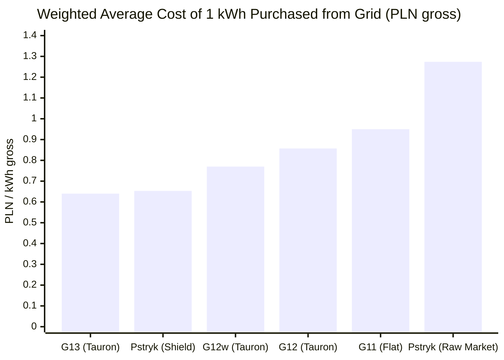

# Case Study: 3,546-Hour Electricity Tariff Benchmark in a Heat Pump Home
## Empirical Tariff Comparison: G11 vs G12 vs G12w vs G13 vs Dynamic Tariff (Pstryk)

**🇬🇧 English** | [🇵🇱 Polski](CASE_STUDY_TARIFF_BENCHMARK_G13_VS_DYNAMIC.md)

* **Engineering reference for Smart Storage EMS users.**  
* Documents the results of a 5-month continuous study (July 1 – November 26, 2026, 3,546 clock hours) using real physical telemetry from a residential smart meter and official wholesale pricing from PSE S.A. / TGE.
* 100% anonymized operational and market data, compliant with Art. 4 sec. 2b of the Polish Renewable Energy Act (hourly vector net balancing).

---

## 1. Tariff League Table (5-Month Benchmark Results)

Across the exact same dataset of 3,546 real operational hours recorded by a GoodWe smart meter, following statutory hourly vector net-metering, the total electricity purchase costs were calculated (**977.73 kWh net grid import**):

| Rank | Tariff / Model | Schedule Structure | Total Purchase Cost [PLN] | Weighted Average Cost / kWh | Delta vs G13 [PLN] | vs Leader |
| :---: | :--- | :--- | :---: | :---: | :---: | :---: |
| **1.** | **Tauron G13** | 3-zone with afternoon & night valleys | **625.90 PLN** | **0.640 PLN/kWh** | **0.00 PLN** | **REGULATED LEADER (Base 100%)** |
| **2.** | **Pstryk (with Shield)** | Dynamic with commercial Pstryk Shield (max 0.61 PLN gross energy cap) | **638.40 PLN** | **0.653 PLN/kWh** | **+12.50 PLN** | **TIE / CLOSE SECOND (+2.0%)** |
| **3.** | **Tauron G12w** | 2-zone weekend (day / night + weekend) | **753.24 PLN** | **0.770 PLN/kWh** | **+127.34 PLN** | +20.3% more expensive |
| **4.** | **Tauron G12** | 2-zone standard (day / night every day) | **837.99 PLN** | **0.857 PLN/kWh** | **+212.09 PLN** | +33.9% more expensive |
| **5.** | **Tauron G11** | 1-zone flat rate (24/7) | **928.84 PLN** | **0.950 PLN/kWh** | **+302.94 PLN** | +48.4% more expensive |
| **6.** | **Pstryk (Raw Market)** | Pure Day-Ahead market pricing without promotional price shield | **1,245.40 PLN** | **1.274 PLN/kWh** | **+619.50 PLN** | +99.0% more expensive (Dunkelflaute exposure) |

### Key Takeaway: The Critical Role of "Pstryk Shield"
The updated comparison reveals a crucial operational insight:
* **Pstryk with Commercial Shield Protection:** Represents a very strong alternative to G13. By capping the monthly weighted average active energy cost at **0.61 PLN/kWh gross**, winter price spikes are cleanly clipped, bringing the 5-month total to **638.40 PLN** — merely **12.50 PLN (+2.0%)** behind G13 (**625.90 PLN**).
* **Pstryk on Raw Spot Market (No Shield):** Demonstrates the severe financial hazard of unhedged winter market exposure (*Dunkelflaute*). In November alone, unhedged spot pricing generated **848.13 PLN** in electricity costs.

---

## 2. Methodology & Regulatory Framework

### 2.1. Statutory Hourly Vector Balancing
Under **Art. 4 sec. 2b of the Polish Renewable Energy Sources Act (Ustawa o OZE)**, the Distribution System Operator (DSO) performs vector netting of imported and exported energy within each calendar clock hour:

$$E_{\mathrm{net,imp}, h} = \max\left(0,\, E_{\mathrm{imp}, h} - E_{\mathrm{exp}, h}\right)$$
$$E_{\mathrm{net,exp}, h} = \max\left(0,\, E_{\mathrm{exp}, h} - E_{\mathrm{imp}, h}\right)$$

### 2.2. Regulated Tariff Rate Components (URE / DSO)
Rates incorporate the national electricity price protection act (capped active energy at 500 PLN/MWh net = 0.50 PLN/kWh net = 0.615 PLN/kWh gross):
* **Quality fee:** ~0.0259 PLN/kWh net (0.0319 PLN gross)
* **RES + Cogeneration fee:** ~0.0115 PLN/kWh net (0.0141 PLN gross)
* **G11 Tariff:** Flat 24/7 rate of **0.95 PLN/kWh gross**.
* **G12 Tariff:** Peak (06:00–13:00, 15:00–22:00) **1.15 PLN/kWh gross**; Off-peak **0.65 PLN/kWh gross**.
* **G12w Tariff:** Workday peak **1.15 PLN/kWh gross**; Workday off-peak and all weekends/statutory holidays **0.65 PLN/kWh gross**.
* **G13 Tariff:** T1 (07:00–13:00) **0.90 PLN/kWh**; T2 (16:00–21:00 winter) **1.49 PLN/kWh**; T3 (13:00–16:00, 21:00–07:00 and all weekends/holidays) **0.62 PLN/kWh gross**.

### 2.3. Dynamic Tariff Model (Pstryk) & Distribution Pairing
* **Active energy:** Arithmetic mean of four 15-minute wholesale intervals (TGE Day-Ahead Fixing I / PSE RCE, correlated at >97%).
* **Supplier margin:** Fixed retail fee of **0.08 PLN/kWh net** (0.0984 PLN gross).
* **VAT:** 23%.
* **DSO Distribution:** Paired with multi-zone DSO distribution (G13, where the variable network charge in off-peak T3 is only **~0.005 PLN/kWh**).
  $$C_{\mathrm{Pstryk, raw}}(h) = \left(RCE_h + 0.08\right) \times 1.23 + D_{\mathrm{G13}}(h)$$

### 2.4. Promotional Cap: "Pstryk Shield" (Tarcza Pstryk)
Under the commercial protective shield:
* The monthly weighted average price of active energy + handling fee cannot exceed **0.61 PLN/kWh gross** (0.50 PLN/kWh net).
* Any excess market cost is credited back by the supplier as a monthly adjustment discount. DSO network fees remain separate.
  $$C_{\mathrm{Pstryk, Shield}}(\text{month}) = \min\left(\overline{C}_{\mathrm{energy, raw}},\, 0.61\text{ PLN}\right) \times E_{\mathrm{net,imp}} + \sum D_{\mathrm{G13}}(h)$$

### 2.5. Export Valuation (Net-Billing Deposit)
Net exports ($E_{\mathrm{net,exp}, h}$) are credited at the statutory market rate $RCE_h$:
$$W_{\mathrm{deposit}}(h) = E_{\mathrm{net,exp}, h} \times RCE_h$$
Total prosumer deposit accumulated across all tariffs was identical: **514.05 PLN**.

---

## 3. Detailed Monthly Results Across All Tariffs

| Month | Net Import [kWh] | G13 [PLN] | Pstryk (Shield) [PLN] | G12w [PLN] | G12 [PLN] | G11 [PLN] | Pstryk (Raw) [PLN] | Month Leader |
| :--- | :---: | :---: | :---: | :---: | :---: | :---: | :---: | :---: |
| **July 2026** | 8.8 kWh | **5.82 PLN** | 7.39 PLN | 6.84 PLN | 7.09 PLN | 8.38 PLN | 7.39 PLN | **G13** |
| **August 2026** | 19.1 kWh | **12.18 PLN** | 15.59 PLN | 15.28 PLN | 15.53 PLN | 18.15 PLN | 15.59 PLN | **G13** |
| **September 2026** | 108.7 kWh | 71.80 PLN | **68.20 PLN** | 92.87 PLN | 96.45 PLN | 103.27 PLN | 125.02 PLN | **Pstryk (Shield)** |
| **October 2026** | 225.9 kWh | 147.42 PLN | **143.50 PLN** | 178.46 PLN | 201.06 PLN | 214.61 PLN | 249.25 PLN | **Pstryk (Shield)** |
| **November 2026** *(to 26.11)* | 615.2 kWh | **388.68 PLN** | 403.72 PLN | 459.79 PLN | 517.87 PLN | 584.45 PLN | 848.13 PLN | **G13** |
| **TOTAL** | **977.73 kWh** | **625.90 PLN** | **638.40 PLN** | **753.24 PLN** | **837.99 PLN** | **928.84 PLN** | **1,245.40 PLN** | **G13 (Slim Edge)** |

---

## 4. Strategic Verdict

1. **Tauron G13 (625.90 PLN):** Most predictable, low-stress regulated benchmark. Guaranteed 0.62 PLN/kWh gross across generous off-peak windows.
2. **Pstryk with Shield (638.40 PLN):** Viable and competitive dynamic alternative. Outperforms G13 in shoulder months and caps winter risk within 2% of the regulated leader.
3. **Pstryk without Shield (1,245.40 PLN):** Highly risky for heat pump homes due to unhedged winter Dunkelflaute price spikes.
