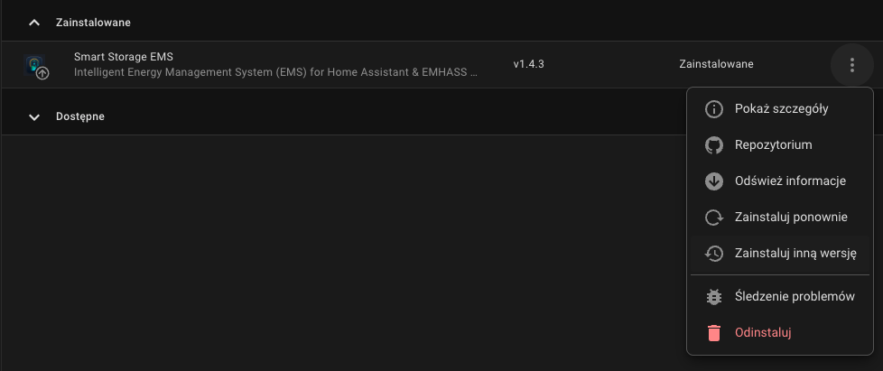
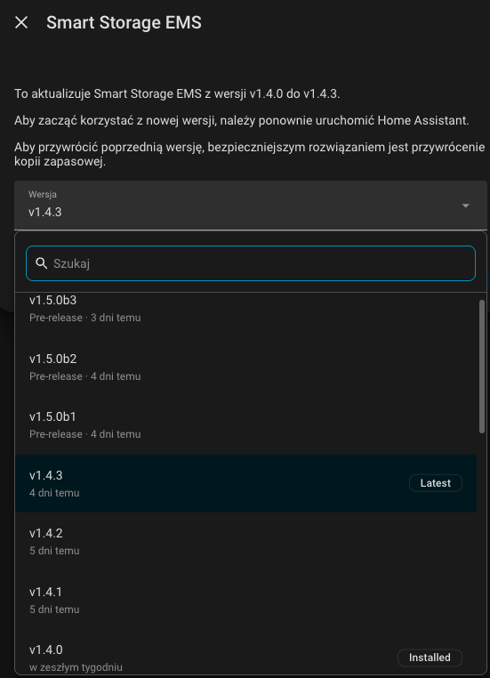
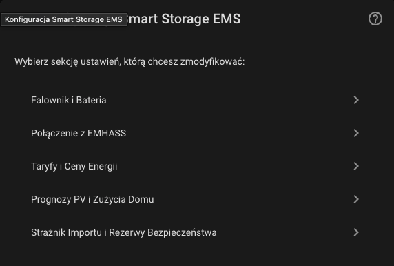

# 🚀 Jak zainstalować wersję BETA integracji Smart Storage EMS (Krok po kroku)

  <strong>🇵🇱 Polski</strong> &nbsp;|&nbsp; <a href="HOWTO_INSTALL_BETA_EN.md">🇬🇧 English</a>

Nowe sterowniki inwerterów (**Deye / SunSynk / Sol-Ark**, **Hoymiles HIT**, **FoxESS**, **Sofar Solar**) oraz najświeższe funkcjonalności znajdują się w kanale przedpremierowym (**BETA / Pre-release**, np. `v1.5.0b3`).

Jeśli masz zainstalowaną wersję stabilną (np. `v1.4.3`), Home Assistant nie wyświetli nowych modeli inwerterów w kreatorze, dopóki nie pobierzesz wydania BETA w HACS.

Poniżej znajduje się krótka, 3-minutowa instrukcja ze zrzutami ekranu.

---

## Część 1: Pobranie wersji BETA w HACS

### Krok 1: Otwórz menu wersji w HACS
1. W Home Assistant przejdź do zakładki **HACS** -> sekcja zainstalowane integracje.
2. Przy pozycji **Smart Storage EMS** kliknij ikonę **trzech pionowych kropek (⋮)** po prawej stronie.
3. Z menu kontekstowego wybierz **Zainstaluj inną wersję** (*Redownload* / *Install another version*).

---

### Krok 2: Wybierz najnowsze wydanie Pre-release (BETA)
1. W oknie dialogowym rozwiń listę dostępnych wersji.
2. Zaznacz najnowszą wersję z dopiskiem **`Pre-release`** znajdującą się na samej górze (np. **`v1.5.0b3`**).
3. Kliknij przycisk **Zainstaluj** (*Download*).

---

## Część 2: Restart Home Assistant (Konieczny!)

Po pobraniu nowych plików przez HACS, Home Assistant musi załadować nowy kod Pythona:
1. Wejdź w **Ustawienia** -> **System**.
2. W prawym górnym rogu kliknij ikonę zasilania i wybierz **Uruchom ponownie Home Assistant**.
3. Odczekaj chwilę, aż system wstanie.

---

## Część 3: Konfiguracja falownika w Home Assistant

### Krok 3: Otwórz ustawienia falownika
1. Przejdź do: **Ustawienia** -> **Urządzenia oraz usługi** -> zakładka **Integracje**.
2. Odszukaj kafelek **Smart Storage EMS** i kliknij przycisk **Konfiguruj** (*Configure*).
3. W menu wyboru sekcji kliknij **Falownik i Bateria**.

---

### Krok 4: Wybierz profil swojego inwertera (BETA)
1. W polu **Typ falownika** rozwiń listę wyboru.
2. Zobaczysz teraz odblokowane profile BETA:
   - **`Deye / SunSynk / Sol-Ark [BETA]`**
   - **`Hoymiles HIT-(5–20)L-G3 [BETA]`**
   - **`Sofar Solar (HYD 3K-6K-ES / EP, HYD-3PH) [BETA]`**
   - **`FoxESS (H1 / H3 / AIO / KH) [BETA]`**
3. Wybierz swój model inwertera, kliknij **Zatwierdź** i wskaż encje sterujące z list rozwijanych (np. sensory i przełączniki wystawione przez ESPHome Lewa-Ręka lub Solarman).

![Krok 4: Wybór Deye / SunSynk [BETA] na liście falowników](images/ha-step4-select-deye-beta-inverter.png)

---

### ❓ Masz pytania lub problem z mapowaniem encji?
Zajrzyj do sekcji [Dyskusje na GitHubie](https://github.com/jannowakk/ha-smart-storage-ems/discussions) lub utwórz [Zgłoszenie (Issue)](https://github.com/jannowakk/ha-smart-storage-ems/issues).
