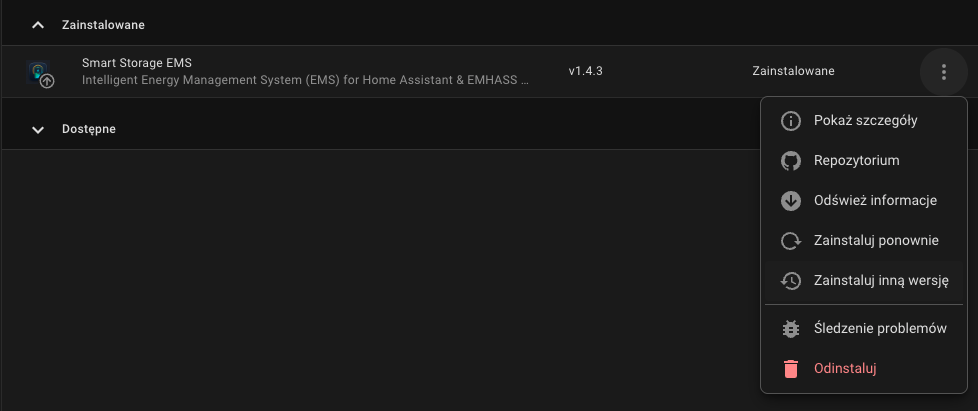
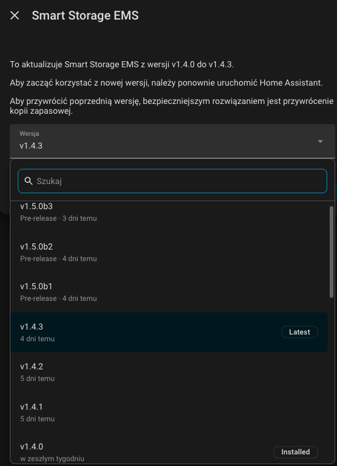
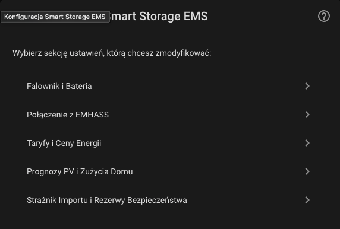

# 🚀 How to Install Smart Storage EMS BETA Versions (Step-by-Step)

  <a href="HOWTO_INSTALL_BETA.md">🇵🇱 Polski</a> &nbsp;|&nbsp; <strong>🇬🇧 English</strong>

New hardware inverter drivers (**Deye / SunSynk / Sol-Ark**, **Hoymiles HIT**, **FoxESS**, **Sofar Solar**) and the latest features are currently available in the pre-release channel (**BETA / Pre-release**, e.g., `v1.5.0b3`).

If you currently have a stable release installed (e.g., `v1.4.3`), Home Assistant will not show these new inverter profiles in the setup wizard until you download the BETA release in HACS.

Here is a quick step-by-step visual guide.

---

## Part 1: Download BETA in HACS

### Step 1: Open Version Selection in HACS
1. In Home Assistant, navigate to **HACS** -> Downloaded Integrations.
2. Find **Smart Storage EMS**, click the **three dots menu (⋮)** on the right side.
3. Select **Install another version** (*Redownload*).

---

### Step 2: Select the Latest Pre-release (BETA)
1. In the modal dialog, expand the version dropdown list.
2. Select the top version marked with **`Pre-release`** (e.g., **`v1.5.0b3`**).
3. Click **Download** / **Install**.

---

## Part 2: Restart Home Assistant (Required!)

After downloading the new files via HACS, Home Assistant must restart to reload the new Python inverter drivers:
1. Go to **Settings** -> **System**.
2. Click the power button in the top right corner and choose **Restart Home Assistant**.
3. Wait for Home Assistant to reboot.

---

## Part 3: Inverter Configuration in Home Assistant

### Step 3: Open Inverter Settings
1. Go to **Settings** -> **Devices & Services** -> **Integrations**.
2. Locate the **Smart Storage EMS** card and click **Configure**.
3. Select the first section: **Inverter & Battery**.

---

### Step 4: Choose Your Inverter Profile (BETA)
1. Expand the **Inverter Type** dropdown list.
2. You will now see the unlocked BETA drivers:
   - **`Deye / SunSynk / Sol-Ark [BETA]`**
   - **`Hoymiles HIT-(5–20)L-G3 [BETA]`**
   - **`Sofar Solar (HYD 3K-6K-ES / EP, HYD-3PH) [BETA]`**
   - **`FoxESS (H1 / H3 / AIO / KH) [BETA]`**
3. Select your model, click **Submit**, and map your control entities from the dropdowns (e.g. entities exposed via ESPHome Modbus or Solarman).

![Step 4: Select Deye / SunSynk [BETA] profile](images/ha-step4-select-deye-beta-inverter.png)

---

### ❓ Questions or Entity Mapping Issues?
Visit [GitHub Discussions](https://github.com/jannowakk/ha-smart-storage-ems/discussions) or open an [Issue](https://github.com/jannowakk/ha-smart-storage-ems/issues).
